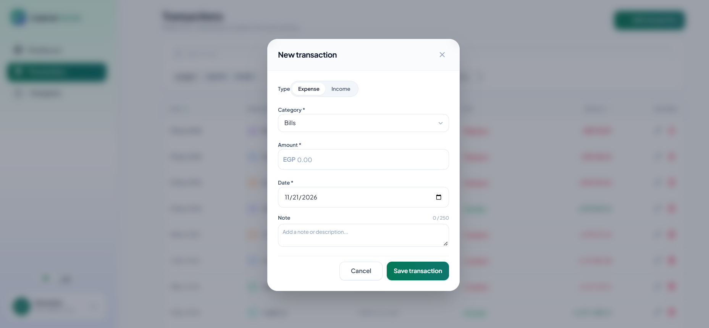
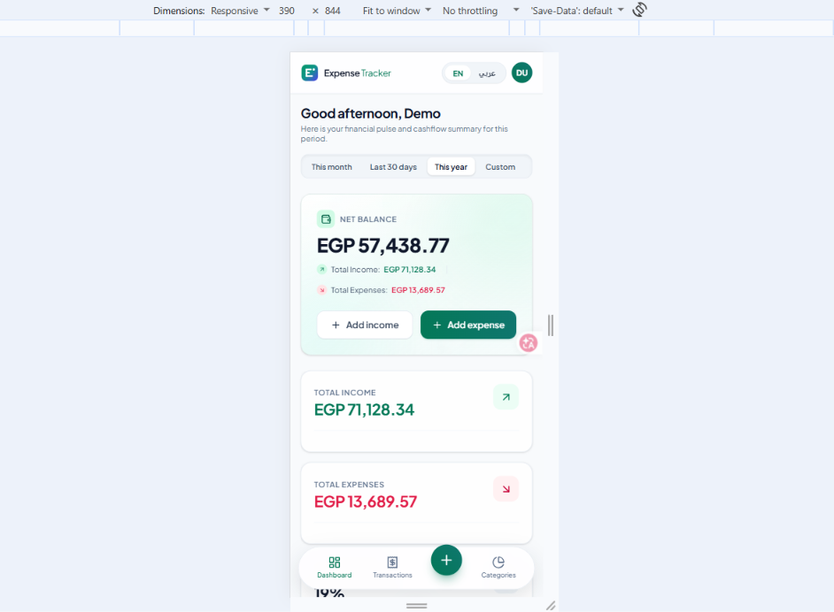
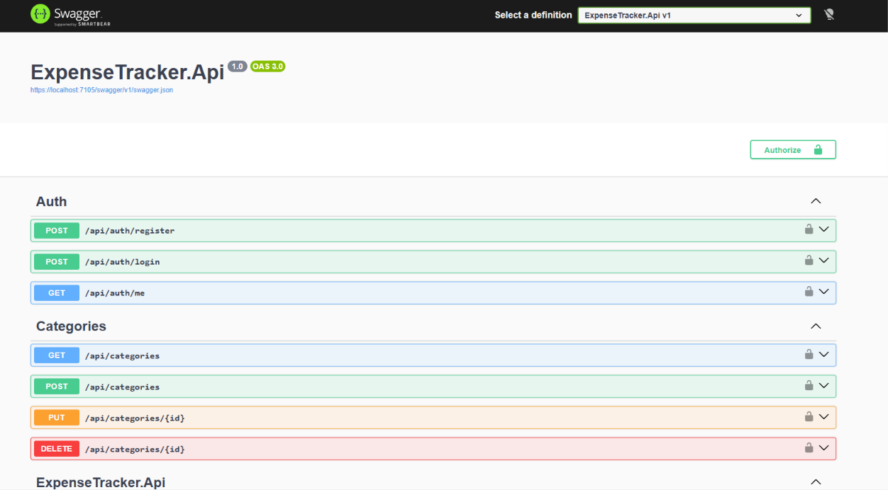
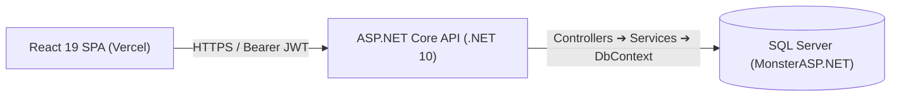

<div align="center">


# Expense Tracker

**Full-stack personal finance web app built with ASP.NET Core Web API (.NET 10), SQL Server, and a bilingual (English LTR / Arabic RTL) React 19 SPA.**

[](https://dotnet.microsoft.com/) [](https://react.dev/) [](https://tailwindcss.com/) [](https://www.microsoft.com/sql-server) [](https://vitest.dev/) [](https://expense-tracker-almaghrabyali.vercel.app) [](https://expensetracker.tryasp.net/health)

[Live Web App](https://expense-tracker-almaghrabyali.vercel.app) • [Live API](https://expensetracker.tryasp.net) • [API Health](https://expensetracker.tryasp.net/health) • [Backend Docs](backend/README.md) • [Frontend Docs](frontend/README.md)

</div>

---

## Overview
Expense Tracker is a fast, responsive personal finance manager for tracking incomes and expenses, organizing custom budgets, and monitoring cash flow. It offers a native bilingual experience in English (LTR) and Arabic (RTL) with Cairo typography, Western digits, and Egyptian Pound (`EGP` / `ج.م`) formatting. Designed for individuals and freelancers who need straightforward financial control without unnecessary complexity.

## Live Demo
- **Web App:** [https://expense-tracker-almaghrabyali.vercel.app](https://expense-tracker-almaghrabyali.vercel.app)
- **API Base URL:** [https://expensetracker.tryasp.net](https://expensetracker.tryasp.net) (serves a landing page at `/` and health check at `/health`)
- **Demo Account:** `demo@example.com` / `Demo12345` (public sandbox with sample data from Aug–Nov 2026)
- **Try it:** Switch between English and Arabic, toggle dashboard date presets, filter and search transactions, and test category deletion rules.

## Screenshots
| View | Screenshot | Description |
| :--- | :---: | :--- |
| **Login** |  | Glass card authentication with input validation |
| **Dashboard (EN)** |  | Balance hero, stat cards, donut chart, and 12-month cashflow |
| **Dashboard (AR)** |  | RTL mirror layout, Cairo font, and localized `ج.م` currency |
| **Transactions** |  | Filter bar, debounced search, sorting, and pagination |
| **Transaction Modal** |  | Income/Expense toggle and category matching |
| **Categories** |  | 12 locked system defaults and custom color-picked categories |
| **Mobile** |  | Compact mobile view with bottom navigation dock |
| **Swagger UI** |  | Interactive OpenAPI documentation (Development only) |

## Features
- **Auth & Security:** Stateless JWT (HS256, 60m expiry, zero clock skew), BCrypt hashing, strict tenant isolation via token claims (foreign IDs return 404), and auto-logout on token expiration.
- **Dashboard & Analytics:** Period presets (This Month, Last 30 Days, This Year, Custom), net balance with previous-period delta, burn rate, Recharts donut, and 12-month bar chart.
- **Transactions:** Server-driven paging, whitelisted sorting (`date`, `amount`, `createdAt`), debounced note search, and validated CRUD modals.
- **Categories:** 12 immutable default categories plus custom categories with a 10-color hex picker; deletion blocked if transactions exist (409 Conflict).
- **UX & Localization:** Full LTR/RTL bidirectional layout, Inter (EN) and Cairo (AR) fonts, EGP currency formatting, responsive mobile dock, and localized RFC 7807 problem details.

## Tech Stack
| Layer | Technologies | Purpose |
| :--- | :--- | :--- |
| **Backend** | ASP.NET Core (.NET 10), C# 14 | RESTful Web API, JWT Bearer auth, DataAnnotations validation |
| **Database** | SQL Server, EF Core 10.0 | Code-first migrations, relational schema, SQL-level aggregations |
| **Frontend** | React 19, Vite 8, Tailwind CSS v4 | SPA, utility-first styling, responsive layout |
| **State & Data** | TanStack React Query 5, Axios | Caching, query invalidation, Bearer auth interceptors |
| **Libraries** | React Router 7, React Hook Form 7, Recharts 3, i18next 26 | Client routing, forms, SVG charts, EN/AR localization |
| **Testing & Hosting** | Vitest 5, ESLint 9; MonsterASP.NET, Vercel | Unit testing, linting; Windows/IIS API hosting, edge static hosting |

## Architecture

The backend uses a layered architecture: **Controllers** (routing, validation) $\to$ **Services** (business rules, tenant isolation) $\to$ **AppDbContext** (EF Core persistence, no redundant repository layer). DTOs are strictly separated from entities. The frontend drives server state via custom React Query hooks connected to an Axios client that attaches tokens and handles 401 session expirations.

## Project Structure
```text
expense-tracker/
├── backend/
│   ├── ExpenseTracker.slnx
│   ├── README.md                               # Detailed backend documentation
│   └── src/ExpenseTracker.Api/                 # Controllers, Services, Data, DTOs, Entities, Migrations
├── frontend/
│   ├── package.json, vite.config.js, vercel.json
│   ├── README.md                               # Detailed frontend documentation
│   └── src/                                    # components/, pages/, hooks/, api/, i18n/, test/
└── docs/screenshots/                           # Walkthrough screenshots (.gitkeep)
```

## Database Design
```mermaid
erDiagram
    Users ||--o{ Categories : "creates (Cascade)"
    Users ||--o{ Transactions : "owns (Cascade)"
    Categories ||--o{ Transactions : "classifies (Restrict)"
    Users { int Id PK, nvarchar Email UK, nvarchar PasswordHash }
    Categories { int Id PK, int UserId FK, nvarchar Name, nvarchar Type, nvarchar Color }
    Transactions { int Id PK, int UserId FK, int CategoryId FK, decimal Amount, date Date, nvarchar Note }
```
Includes indexes on `Users(Email)` (unique), `Transactions(UserId, Date)`, `Categories(UserId)`, and `Transactions(CategoryId)`. Pre-seeded with **12 default categories** (Expense: Food, Transport, Bills, Shopping, Health, Entertainment, Education, Other; Income: Salary, Freelance, Gift, Other).

## API Overview
Full schemas, query parameters, and error status mappings are documented in [backend/README.md](backend/README.md#7-api-reference).

| Method | Endpoint | Auth | Purpose |
| :--- | :--- | :---: | :--- |
| `GET` | `/` | No | API landing page |
| `GET` | `/health` | No | Health check probe (`{"status":"healthy"}`) |
| `POST` | `/api/auth/register` | No | Register new user account |
| `POST` | `/api/auth/login` | No | Authenticate and return JWT token |
| `GET` | `/api/auth/me` | Yes | Retrieve current user profile |
| `GET`, `POST` | `/api/categories` | Yes | List all categories; create custom category |
| `PUT`, `DELETE`| `/api/categories/{id}` | Yes | Update custom category; delete (blocked if transactions exist) |
| `GET`, `POST` | `/api/transactions` | Yes | Paged/filtered transaction list; create transaction |
| `GET`, `PUT`, `DELETE` | `/api/transactions/{id}` | Yes | Read, replace, or delete transaction |
| `GET` | `/api/reports/summary` | Yes | Totals for income, expense, balance, count (`?from=&to=`) |
| `GET` | `/api/reports/by-category`| Yes | Category spending totals and percentages (`?type=&from=&to=`) |
| `GET` | `/api/reports/monthly` | Yes | 12-month annual cashflow breakdown (`?year=`) |

## Running Locally

### Backend (.NET 10 + SQL LocalDB)
```powershell
cd backend
dotnet dev-certs https --trust
dotnet user-secrets set "Jwt:Key" "super-secret-development-key-at-least-32-chars!" --project src/ExpenseTracker.Api
sqllocaldb start MSSQLLocalDB
dotnet ef database update --project src/ExpenseTracker.Api
dotnet run --project src/ExpenseTracker.Api --launch-profile https
# API running at https://localhost:7105 (Swagger at /swagger)
```

### Frontend (React 19 + Vite)
```powershell
cd frontend
npm install
Copy-Item .env.example .env   # sets VITE_API_URL=https://localhost:7105
npm run dev                  # runs on http://localhost:5173
```

### Troubleshooting
| Issue | Cause | Fix |
| :--- | :--- | :--- |
| **CORS error in browser** | Origin is not `http://localhost:5173` | Ensure frontend runs on port 5173 without trailing slashes in API URL. |
| **Port 5173 busy** | Another process holds port 5173 (`strictPort: true`) | Stop conflicting process or run `Stop-Process -Id (Get-NetTCPConnection -LocalPort 5173).OwningProcess`. |
| **API startup crash** | `Jwt:Key` missing or under 32 chars | Run `dotnet user-secrets set "Jwt:Key" "<32+ characters>" --project src/ExpenseTracker.Api`. |

## Configuration Reference
| Key | Environment Variable | Secret? | Purpose |
| :--- | :--- | :---: | :--- |
| `ConnectionStrings:DefaultConnection` | `ConnectionStrings__DefaultConnection` | Yes | SQL Server connection string |
| `Jwt:Key` | `Jwt__Key` | Yes | HMAC-SHA256 signing key (32+ chars) |
| `Jwt:Issuer` / `Jwt:Audience` | `Jwt__Issuer` / `Jwt__Audience` | No | JWT claim validation values |
| `Cors:AllowedOrigins` | `Cors__AllowedOrigins__0`, `__1` | No | Allowed frontend origins (`localhost:5173`, Vercel) |
| `VITE_API_URL` | `VITE_API_URL` | No | Base API URL used by the frontend Axios client |

## Testing & Quality
- **Frontend:** 64 Vitest tests covering date math, EGP currency, i18n key parity, error normalization, and components (`npm test`). Code quality enforced with ESLint (`npm run lint`).
- **Backend:** Verified with an automated 14-check production smoke test suite against `/health`, auth, categories, transactions, and report math.
- **Note:** Automated backend unit tests (`backend/tests/`) are not yet implemented and are planned in the roadmap.

## Deployment
- **Frontend (Vercel):** Hosted at [expense-tracker-almaghrabyali.vercel.app](https://expense-tracker-almaghrabyali.vercel.app). Root Directory `frontend`, Vite preset, output `dist`. Continuous deployment triggers on every push to `main`, with `frontend/vercel.json` rewriting all routes to `/index.html` for client-side routing.
- **Backend (MonsterASP.NET):** Hosted at [expensetracker.tryasp.net](https://expensetracker.tryasp.net) (serves a landing page at `/` and health check at `/health`) with managed SQL Server on Windows Server/IIS (.NET 10 in-process), deployed via Web Deploy. Enforces HTTPS with a Let's Encrypt certificate. Migrations are run manually (`dotnet ef database update --connection "<conn>"`) and never execute at startup. Swagger is restricted to Development.

### Production Environment Variables
| Variable Name | Target | Purpose |
| :--- | :--- | :--- |
| `ConnectionStrings__DefaultConnection` | MonsterASP.NET | Production SQL Server connection string |
| `Jwt__Key` | MonsterASP.NET | 32+ char HMAC-SHA256 signing secret |
| `Cors__AllowedOrigins__1` | MonsterASP.NET | Production frontend origin (no trailing slash) |
| `ASPNETCORE_ENVIRONMENT` | MonsterASP.NET | Set to `Production` (disables Swagger UI) |
| `VITE_API_URL` | Vercel | Production API base URL (`https://expensetracker.tryasp.net`) |

### Common Pitfalls
- **HTTP 500.30 Startup Failure:** Occurs if `Jwt__Key` is missing from the environment or is shorter than 32 characters.
- **CORS Block:** `Cors__AllowedOrigins__1` must match the frontend URL exactly with no trailing slash (`/`).
- **Mixed Content:** An HTTPS frontend cannot call an HTTP API; always configure secure HTTPS endpoints.

## Roadmap
- [ ] Automated backend unit and integration test suite (xUnit, Moq, Testcontainers for SQL Server).
- [ ] Sliding session refresh tokens stored in secure `httpOnly` cookies.
- [ ] Category-based monthly spending budgets with alert thresholds.
- [ ] Export transactions and reports to CSV and PDF formats.
- [ ] Recurring transactions and subscription management.
- [ ] Dark mode theme toggle.

## Author
**Almaghraby Ali** — [GitHub](https://github.com/AlmaghrabyAli)
