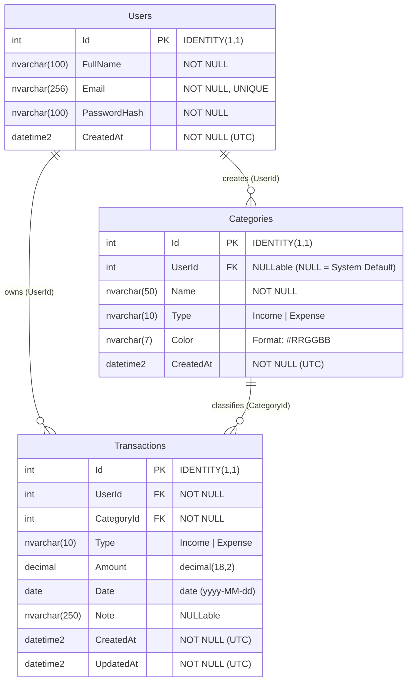

<div align="center">


# Expense Tracker API — Backend Reference

**Production-ready ASP.NET Core Web API on .NET 10 for multi-tenant personal expense and income tracking.**

[](https://dotnet.microsoft.com/)
[](https://learn.microsoft.com/aspnet/core)
[](https://learn.microsoft.com/ef/core)
[](https://www.microsoft.com/sql-server)
[-000000?style=flat&logo=jsonwebtokens&logoColor=white)](https://jwt.io)
[](https://github.com/BcryptNet/bcrypt.net)
[](https://www.monsterasp.net/)
[](https://expensetracker.tryasp.net/health)

---

### Quick Links

| Resource | Target | Notes |
|:---|:---|:---|
| **Live Frontend** | [expense-tracker-almaghrabyali.vercel.app](https://expense-tracker-almaghrabyali.vercel.app) | Bilingual React SPA (EN / AR) |
| **Live API Base URL** | [expensetracker.tryasp.net](https://expensetracker.tryasp.net) | Hosted on Windows/IIS at MonsterASP.NET |
| **Health Check** | [expensetracker.tryasp.net/health](https://expensetracker.tryasp.net/health) | Returns `{"status":"healthy"}` |
| **Swagger UI** | `/swagger` (Local development only) | Disabled in production for security |
| **Public Demo Account** | `demo@example.com` / `Demo12345` | Throw-away demo dataset (Aug–Nov 2026) |
| **Repository Monorepo** | [github.com/AlmaghrabyAli/expense-tracker](https://github.com/AlmaghrabyAli/expense-tracker) | Contains `backend/` and `frontend/` |

</div>

---

## Table of Contents

- [1. Overview & Design Decisions](#1-overview--design-decisions)
- [2. Tech Stack & Dependencies](#2-tech-stack--dependencies)
- [3. Architecture & Request Pipeline](#3-architecture--request-pipeline)
- [4. Project Structure](#4-project-structure)
- [5. Database & Data Model](#5-database--data-model)
  - [Entity-Relationship Diagram](#entity-relationship-diagram)
  - [Schema Definitions & Constraints](#schema-definitions--constraints)
  - [Referential Integrity & Delete Behaviors](#referential-integrity--delete-behaviors)
  - [Code-First Migrations](#code-first-migrations)
  - [Seeded System Categories](#seeded-system-categories)
- [6. Business Rules & Validation](#6-business-rules--validation)
  - [Core Business Rules](#core-business-rules)
  - [Field Validation Matrix](#field-validation-matrix)
- [7. API Reference](#7-api-reference)
  - [Authentication Endpoints](#authentication-endpoints)
  - [Category Endpoints](#category-endpoints)
  - [Transaction Endpoints](#transaction-endpoints)
  - [Report Endpoints](#report-endpoints)
  - [Health Check](#health-check)
- [8. Authentication & Authorization](#8-authentication--authorization)
  - [Authentication Flow](#authentication-flow)
  - [Token Claims & Expiration](#token-claims--expiration)
  - [Secure User Context Extraction](#secure-user-context-extraction)
  - [Error Response Shapes](#error-response-shapes)
- [9. Configuration & Environment Variables](#9-configuration--environment-variables)
- [10. Local Development Setup (Windows PowerShell)](#10-local-development-setup-windows-powershell)
  - [Prerequisites](#prerequisites)
  - [Step-by-Step Instructions](#step-by-step-instructions)
  - [Database Migrations Management](#database-migrations-management)
  - [Troubleshooting Local Setup](#troubleshooting-local-setup)
- [11. Testing & Verification](#11-testing--verification)
  - [Production Smoke Test Suite](#production-smoke-test-suite)
  - [Hand-Verified Report Calculations](#hand-verified-report-calculations)
  - [Current State of Unit Tests](#current-state-of-unit-tests)
  - [Automated PowerShell Smoke Test Script](#automated-powershell-smoke-test-script)
- [12. Production Deployment (MonsterASP.NET)](#12-production-deployment-monsteraspnet)
  - [Hosting Environment](#hosting-environment)
  - [Deployment Workflow](#deployment-workflow)
  - [Remote Database Migrations](#remote-database-migrations)
  - [Production Pitfalls & Diagnostics](#production-pitfalls--diagnostics)
- [13. Security Considerations](#13-security-considerations)
- [14. Project Roadmap](#14-project-roadmap)
- [15. Project Context & Attribution](#15-project-context--attribution)

---

## 1. Overview & Design Decisions

The Expense Tracker API is a RESTful service designed to support modern personal accounting workflows: recording multi-currency expenses and incomes, classifying them into custom or default categories, and computing real-time statistical aggregations. 

The architecture balances enterprise standards with practical simplicity:

1. **Explicit Layered Architecture (Controllers $\to$ Services $\to$ DbContext):**
   Controllers handle HTTP transport concerns, model validation, and route parameters. Services encapsulate all business logic, validation rules, and access authorization. `AppDbContext` handles persistence.
2. **Deliberate Absence of a Repository Layer:**
   Entity Framework Core already implements the Repository and Unit of Work patterns natively (`DbSet<T>` and `DbContext`). Introducing a generic `IRepository<T>` over EF Core creates an unnecessary layer of indirection that obscures compile-time LINQ translation, hampers projection via `.Select()`, and adds boilerplate without providing tangible isolation benefits for this service scope.
3. **Rigid Separation of DTOs and Entities:**
   Domain entities are never accepted from or returned to the client directly. Input DTOs enforce validation rules via `System.ComponentModel.DataAnnotations` attributes, preventing mass-assignment and over-posting vulnerabilities. Output DTOs strictly expose only the data intended for the client.
4. **Centralized Exception Handling Middleware:**
   Instead of scattering `try-catch` blocks across controllers, business services throw semantic exceptions derived from `AppException` (such as `NotFoundException`, `ConflictException`, or `BadRequestException`). A custom `ExceptionHandlingMiddleware` intercepts them and writes an RFC 7807 `ProblemDetails` response (`application/problem+json`). Unhandled exceptions log complete diagnostic details to the server log and return a sanitized HTTP 500 error without exposing stack traces.
5. **Stateless JWT Authentication:**
   Authentication uses HMAC-SHA256 signed JSON Web Tokens with a 60-minute lifetime. Tokens are stateless; there is no database lookup on authenticated endpoints. Logout is executed client-side by discarding the token.
6. **Strict Multi-Tenant Isolation by Design:**
   Every database query and mutation is filtered by `UserId`, resolved directly from the verified cryptographic `sub` claim of the JWT. Clients cannot pass a `userId` in route parameters, request bodies, or query strings to access another user's data. Cross-user access attempts resolve to `404 Not Found`, ensuring existence of other users' records is never disclosed.
7. **Database-Level Aggregation:**
   Report queries (`/api/reports/summary`, `/api/reports/by-category`, and `/api/reports/monthly`) leverage SQL Server `GROUP BY` and `SUM` operations via EF Core LINQ. Raw transaction lists are never loaded into memory for aggregation, guaranteeing $O(1)$ memory consumption regardless of transaction count.

---

## 2. Tech Stack & Dependencies

The backend targets **.NET 10.0** (C# 14) and uses modern ASP.NET Core minimal service registration.

| Package | Version | Purpose |
|:---|:---|:---|
| **`Microsoft.AspNetCore.Authentication.JwtBearer`** | `10.0.14` | Middleware for parsing and validating Bearer JWT tokens |
| **`Microsoft.EntityFrameworkCore.SqlServer`** | `10.0.14` | Entity Framework Core provider for Microsoft SQL Server |
| **`Microsoft.EntityFrameworkCore.Design`** | `10.0.14` | Design-time tooling for code-first migrations and schema management |
| **`BCrypt.Net-Next`** | `4.2.0` | Password hashing utilizing salted Blowfish encryption |
| **`Swashbuckle.AspNetCore`** | `10.3.1` | Swagger generator and Swagger UI interactive documentation with Bearer auth |
| **`Microsoft.AspNetCore.OpenApi`** | `10.0.11` | Built-in ASP.NET Core OpenAPI endpoint explorer |
| **`System.Security.Cryptography.Pkcs`** | `10.0.14` | Cryptographic syntax standard support |

---

## 3. Architecture & Request Pipeline

HTTP requests pass through a strictly ordered ASP.NET Core middleware pipeline defined in `src/ExpenseTracker.Api/Program.cs`:

```mermaid
flowchart TD
    Client["Client (Browser / React SPA / Curl)"] -->|HTTP Request| ExMiddleware["1. ExceptionHandlingMiddleware<br/>(RFC 7807 ProblemDetails)"]
    
    ExMiddleware --> DevCheck{Is Development?}
    DevCheck -->|Yes| Swagger["2. UseSwagger & UseSwaggerUI<br/>(/swagger)"]
    DevCheck -->|No (Production)| HttpsRedir["3. UseHttpsRedirection<br/>(Forces HTTPS)"]
    Swagger --> HttpsRedir
    
    HttpsRedir --> Cors["4. UseCors ('Frontend' Policy)<br/>(Origin, Headers, Methods)"]
    Cors --> AuthN["5. UseAuthentication<br/>(Validates JWT Bearer & Claims)"]
    AuthN --> AuthZ["6. UseAuthorization<br/>(Enforces [Authorize] attributes)"]
    
    AuthZ --> Endpoints["7. Endpoint Routing"]
    Endpoints -->|GET /health| HealthCheck["Health Endpoint<br/>(200 OK {'status':'healthy'})"]
    Endpoints -->|/api/*| Controllers["API Controllers<br/>([ApiController] Model Validation)"]
    
    subgraph ControllersLayer["Controllers Layer"]
        AuthController["AuthController"]
        CatController["CategoriesController"]
        TxController["TransactionsController"]
        RepController["ReportsController"]
    end
    
    Controllers --> ControllersLayer
    
    subgraph ServicesLayer["Service Layer (Scoped DI)"]
        AuthService["AuthService"]
        CategoryService["CategoryService"]
        TxService["TransactionService"]
        RepService["ReportService"]
    end
    
    AuthController --> AuthService
    CatController --> CategoryService
    TxController --> TxService
    RepController --> RepService
    
    subgraph DataLayer["Persistence Layer"]
        AppDbContext["AppDbContext (EF Core)"]
    end
    
    ServicesLayer --> AppDbContext
    AppDbContext -->|SQL Queries & Commands| SqlServer[("SQL Server / LocalDB")]
```

### Middleware Pipeline Order
1. **`ExceptionHandlingMiddleware`**: Outermost handler. Captures exceptions from any downstream component and renders uniform JSON error payloads.
2. **`UseSwagger` & `UseSwaggerUI`**: Active exclusively when `ASPNETCORE_ENVIRONMENT=Development`. Serves OpenAPI specifications at `/swagger`.
3. **`UseHttpsRedirection`**: Enforces SSL/TLS communication.
4. **`UseCors`**: Evaluates browser preflight (`OPTIONS`) and cross-origin requests against origins specified in `Cors:AllowedOrigins`.
5. **`UseAuthentication`**: Inspects `Authorization: Bearer <token>` headers, verifies token signatures, lifetime, issuer, and audience, and establishes the `HttpContext.User` principal.
6. **`UseAuthorization`**: Verifies that protected controllers/actions satisfy authorization criteria (`[Authorize]`).
7. **`MapControllers` & `MapGet("/health")`**: Dispatches requests to controller action methods or minimal API endpoints.

---

## 4. Project Structure

The project follows a clean, single-project Web API structure inside `src/ExpenseTracker.Api`:

```
backend/
├── ExpenseTracker.slnx                         # .NET Solution file (VS 2026 format)
├── README.md                                   # Backend reference documentation (this file)
└── src/
    └── ExpenseTracker.Api/
        ├── ExpenseTracker.Api.csproj           # Target framework, dependencies & UserSecrets configuration
        ├── Program.cs                          # Application bootstrapping, DI setup & middleware pipeline
        ├── appsettings.json                    # Base configuration (Connection strings, JWT settings, CORS)
        ├── appsettings.Development.json        # Development overrides (Logging levels)
        │
        ├── Controllers/                        # HTTP API Endpoints
        │   ├── AuthController.cs               # Register, Login, Current User (/api/auth)
        │   ├── CategoriesController.cs         # Category management (/api/categories)
        │   ├── ReportsController.cs            # Aggregations, summaries & monthly charts (/api/reports)
        │   └── TransactionsController.cs       # Transaction management & pagination (/api/transactions)
        │
        ├── Data/                               # Database context & migrations
        │   ├── AppDbContext.cs                 # EF Core DbContext, Fluent API mapping & seed data
        │   └── Migrations/                     # Code-first migration snapshots
        │       ├── 20261102103341_InitialCreate.cs
        │       ├── 20261102104955_SeedDefaultCategories.cs
        │       └── AppDbContextModelSnapshot.cs
        │
        ├── Dtos/                               # Data Transfer Objects & Contracts
        │   ├── AuthResponse.cs                 # Authentication token and user payload
        │   ├── CategoryDto.cs                  # Category response model
        │   ├── CategoryTotalDto.cs             # Aggregated category sum & calculated percentage
        │   ├── CreateCategoryRequest.cs        # Category creation input validation
        │   ├── CreateTransactionRequest.cs     # Transaction creation input validation
        │   ├── LoginRequest.cs                 # Login credential input validation
        │   ├── MonthlyReportItemDto.cs         # Monthly aggregated breakdown item (months 1-12)
        │   ├── PagedResult.cs                  # Generic pagination wrapper
        │   ├── RegisterRequest.cs              # Registration input validation
        │   ├── SummaryDto.cs                   # Top-level financial totals & balance
        │   ├── TransactionDto.cs               # Transaction response model
        │   ├── TransactionQuery.cs             # Filter, sort, and pagination query parameters
        │   ├── UpdateCategoryRequest.cs        # Category update input validation
        │   ├── UpdateTransactionRequest.cs     # Full transaction replacement payload
        │   └── UserDto.cs                      # Public user profile response
        │
        ├── Entities/                           # Domain Entities
        │   ├── Category.cs                     # Category domain model (System & Custom)
        │   ├── Transaction.cs                  # Financial transaction domain model
        │   ├── TransactionType.cs              # Transaction type enum: Income (1), Expense (2)
        │   └── User.cs                         # User account domain model
        │
        ├── Exceptions/                         # Custom Domain Exceptions
        │   └── AppException.cs                 # Base AppException and 400, 401, 403, 404, 409 subclasses
        │
        ├── Extensions/                         # Utility Extensions
        │   └── ClaimsPrincipalExtensions.cs   # Safe parsing of integer UserId from JWT claims
        │
        ├── Middleware/                         # Custom Middlewares
        │   └── ExceptionHandlingMiddleware.cs  # Centralized RFC 7807 ProblemDetails exception filter
        │
        ├── Properties/                         # Environment & deployment properties
        │   ├── launchSettings.json             # Kestrel launch profiles (HTTP 5041, HTTPS 7105)
        │   └── PublishProfiles/                # Web Deploy profiles (.gitignore protected)
        │
        ├── Services/                           # Business Logic Layer
        │   ├── AuthService.cs                  # User registration, BCrypt verification, JWT generation
        │   ├── CategoryService.cs              # Category ownership, uniqueness & deletion safety
        │   ├── IAuthService.cs                 # Authentication service contract
        │   ├── ICategoryService.cs             # Category service contract
        │   ├── IReportService.cs               # Financial reporting service contract
        │   ├── ITransactionService.cs          # Transaction service contract
        │   ├── ReportService.cs                # SQL-level reporting queries & data calculation
        │   └── TransactionService.cs           # Transaction querying, sorting, and type consistency
        │
        └── Validation/                         # Custom Validation Attributes
            └── MaxDecimalPlacesAttribute.cs    # Custom DataAnnotation to validate decimal precision
```

---

## 5. Database & Data Model

The persistence layer uses SQL Server with code-first migrations managed via Entity Framework Core.

### Entity-Relationship Diagram



### Schema Definitions & Constraints

#### Table: `Users`
Stores registered user accounts and credentials.
| Column | Type | Nullable | Constraints & Description |
|:---|:---|:---:|:---|
| `Id` | `int` | No | Primary Key, `IDENTITY(1,1)` |
| `FullName` | `nvarchar(100)` | No | Maximum 100 characters |
| `Email` | `nvarchar(256)` | No | Normalized lower-case email; Unique Index (`IX_Users_Email`) |
| `PasswordHash` | `nvarchar(100)` | No | BCrypt salted hash string |
| `CreatedAt` | `datetime2` | No | UTC creation timestamp |

#### Table: `Categories`
Stores transaction classifications. A category is either a system-wide default (`UserId = NULL`) or a user-specific custom category (`UserId = <id>`).
| Column | Type | Nullable | Constraints & Description |
|:---|:---|:---:|:---|
| `Id` | `int` | No | Primary Key, `IDENTITY(1,1)` |
| `UserId` | `int` | **Yes** | Foreign Key to `Users(Id)`. `NULL` indicates a shared system default. Index (`IX_Categories_UserId`) |
| `Name` | `nvarchar(50)` | No | Category name, max 50 chars |
| `Type` | `nvarchar(10)` | No | Enum converted to string: `'Income'` or `'Expense'` |
| `Color` | `nvarchar(7)` | No | Hex color code string, max 7 chars (e.g. `#F97316`) |
| `CreatedAt` | `datetime2` | No | UTC creation timestamp |

#### Table: `Transactions`
Stores financial transactions.
| Column | Type | Nullable | Constraints & Description |
|:---|:---|:---:|:---|
| `Id` | `int` | No | Primary Key, `IDENTITY(1,1)` |
| `UserId` | `int` | No | Foreign Key to `Users(Id)` |
| `CategoryId` | `int` | No | Foreign Key to `Categories(Id)`. Index (`IX_Transactions_CategoryId`) |
| `Type` | `nvarchar(10)` | No | Enum converted to string: `'Income'` or `'Expense'` |
| `Amount` | `decimal(18,2)` | No | Currency value with 2 decimal precision (0.01 to 999,999,999.99) |
| `Date` | `date` | No | Calendar date of transaction (`yyyy-MM-dd`) |
| `Note` | `nvarchar(250)` | **Yes** | Optional user description, max 250 characters |
| `CreatedAt` | `datetime2` | No | UTC timestamp when record was inserted |
| `UpdatedAt` | `datetime2` | No | UTC timestamp when record was last updated |

### Referential Integrity & Delete Behaviors

- **`Users` $\to$ `Categories`:** `DeleteBehavior.Cascade`. Deleting a user deletes all custom categories created by that user.
- **`Users` $\to$ `Transactions`:** `DeleteBehavior.Cascade`. Deleting a user deletes all transactions owned by that user.
- **`Categories` $\to$ `Transactions`:** `DeleteBehavior.Restrict` (`NO ACTION` in SQL Server). A category cannot be deleted while transactions still reference it. Deleting a category with active transactions throws a `ConflictException` (HTTP 409).
- **Composite Index:** `IX_Transactions_UserId_Date` on `(UserId, Date)`. Optimizes date-bounded queries and monthly reports partitioned per user.

### Code-First Migrations

| Migration Name | Applied Changes |
|:---|:---|
| `20261102103341_InitialCreate` | Creates `Users`, `Categories`, and `Transactions` tables, defines primary keys, foreign keys, column constraints, and indexes. |
| `20261102104955_SeedDefaultCategories` | Seeds the 12 immutable system categories with fixed primary keys `1` through `12` and `UserId = NULL`. |

### Seeded System Categories

The system includes 12 shared categories (`UserId = NULL`, `CreatedAt = 2026-01-01 00:00:00 UTC`):

| ID | Name | Type | Hex Color | Intended Use |
|:---:|:---|:---:|:---:|:---|
| `1` | **Food** | `Expense` | `#F97316` | Groceries, restaurants, cafes |
| `2` | **Transport** | `Expense` | `#3B82F6` | Public transit, fuel, taxi, maintenance |
| `3` | **Bills** | `Expense` | `#EF4444` | Utilities, internet, rent, subscriptions |
| `4` | **Shopping** | `Expense` | `#EC4899` | Clothing, electronics, personal goods |
| `5` | **Health** | `Expense` | `#10B981` | Medical care, pharmacy, health insurance |
| `6` | **Entertainment** | `Expense` | `#8B5CF6` | Cinema, gaming, outings, hobbies |
| `7` | **Education** | `Expense` | `#06B6D4` | Courses, books, tuition, certifications |
| `8` | **Other** | `Expense` | `#64748B` | Miscellaneous expenses |
| `9` | **Salary** | `Income` | `#22C55E` | Regular employment income |
| `10` | **Freelance** | `Income` | `#14B8A6` | Freelancing, contract work, side projects |
| `11` | **Gift** | `Income` | `#F59E0B` | Gifts, bonuses, monetary grants |
| `12` | **Other** | `Income` | `#64748B` | Miscellaneous income |

---

## 6. Business Rules & Validation

### Core Business Rules

| Domain Rule | Enforcement Mechanism | Result on Violation |
|:---|:---|:---|
| **Data Isolation** | All queries filter by `UserId == User.GetUserId()`. Lookups for missing IDs or IDs owned by another user return identical errors. | `404 Not Found` (Prevents resource existence probing) |
| **System Category Immutability** | `CategoryService` verifies `UserId != null` before updating or deleting a category. | `403 Forbidden` (`Default categories cannot be edited or deleted.`) |
| **Category Deletion Safety** | `CategoryService` checks `Transactions.AnyAsync(t => t.CategoryId == id)` prior to deletion. | `409 Conflict` (`This category has transactions. Move or delete them first...`) |
| **Category Name Uniqueness** | `NameExistsAsync` checks for duplicate names across user's categories AND system categories for that type (case-insensitive). | `409 Conflict` (`A {Type} category named '{Name}' already exists.`) |
| **Category Type Immutability** | `UpdateCategoryRequest` intentionally excludes `Type`. Category type cannot be modified after creation. | Prevents breaking existing transactions tied to the category. |
| **Transaction Category Compatibility** | `GetUsableCategoryAsync` verifies `category.Type == request.Type`. | `400 Bad Request` (`Category '{Name}' is an {Type} category and cannot be used...`) |
| **Category Usability** | Transaction creation/update requires `CategoryId` to belong to system categories (`UserId == null`) or the user's custom categories. | `400 Bad Request` (`Category not found.`) |
| **Email Normalization** | Emails are trimmed and transformed to lower-case via `Trim().ToLowerInvariant()` prior to DB lookup or storage. | Guarantees case-insensitive unique email matching. |
| **Account Enumeration Defense** | `AuthService.LoginAsync` uses a single generic message for both non-existent emails and incorrect passwords. | `401 Unauthorized` (`Invalid email or password.`) |
| **Date Range Logical Order** | If both `from` and `to` are supplied in query parameters, `from` must be $\le$ `to`. | `400 Bad Request` (`'from' must not be later than 'to'.`) |
| **Report Year Bounds** | Monthly report `year` parameter must fall within the range $2000 \le \text{year} \le 2100$. | `400 Bad Request` (`year must be between 2000 and 2100.`) |
| **Currency Amount Range** | Transaction amounts must be strictly greater than 0, maximum 999,999,999.99, and restricted to 2 decimal places. | `400 Bad Request` (DataAnnotations & `MaxDecimalPlacesAttribute`) |

### Field Validation Matrix

| DTO | Property | Rules & DataAnnotations | Failure Error Message |
|:---|:---|:---|:---|
| **`RegisterRequest`** | `FullName` | `[Required]`, `[StringLength(100, MinimumLength = 2)]` | Required; length between 2 and 100 characters |
| | `Email` | `[Required]`, `[EmailAddress]`, `[StringLength(256)]` | Must be a valid email format, max 256 characters |
| | `Password` | `[Required]`, `[StringLength(72, MinimumLength = 8)]` | Required; 8–72 characters (72-byte BCrypt boundary) |
| **`LoginRequest`** | `Email` | `[Required]`, `[EmailAddress]`, `[StringLength(256)]` | Must be a valid email address |
| | `Password` | `[Required]`, `[StringLength(72)]` | Required; max 72 characters |
| **`CreateCategoryRequest`** | `Name` | `[Required]`, `[StringLength(50, MinimumLength = 1)]` | Required; 1 to 50 characters |
| | `Type` | `[Required]`, `[EnumDataType(typeof(TransactionType))]` | Must be `"Income"` or `"Expense"` |
| | `Color` | `[Required]`, `[RegularExpression("^#[0-9A-Fa-f]{6}$")]` | `"Color must be a hex value like #22C55E."` |
| **`UpdateCategoryRequest`** | `Name` | `[Required]`, `[StringLength(50, MinimumLength = 1)]` | Required; 1 to 50 characters |
| | `Color` | `[Required]`, `[RegularExpression("^#[0-9A-Fa-f]{6}$")]` | `"Color must be a hex value like #22C55E."` |
| **`CreateTransactionRequest`** | `Type` | `[EnumDataType(typeof(TransactionType))]` | Must be `"Income"` or `"Expense"` |
| | `CategoryId` | `[Range(1, int.MaxValue)]` | `"CategoryId is required."` |
| | `Amount` | `[Range(0.01, 999999999.99)]`, `[MaxDecimalPlaces(2)]` | Amount must be positive; at most 2 decimal places |
| | `Date` | `[Required]` on `DateOnly?` | Date is required (`yyyy-MM-dd`); rejects empty/null |
| | `Note` | `[StringLength(250)]` | Max 250 characters; trimmed, empty string saved as `null` |
| **`TransactionQuery`** | `Page` | `[Range(1, int.MaxValue)]`, default `1` | Page index must be $\ge 1$ |
| | `PageSize` | `[Range(1, 100)]`, default `10` | Page size must be between 1 and 100 |
| | `SortBy` | Checked against whitelist: `"date"`, `"amount"`, `"createdAt"` | `400 Bad Request` if outside whitelist |
| | `SortDir` | Checked against whitelist: `"asc"`, `"desc"` | `400 Bad Request` if outside whitelist |

---

## 7. API Reference

All API routes are prefixed with `/api` (except `/health`). Dates follow ISO-8601 calendar format (`yyyy-MM-dd`). Enums are serialized as strings.

### Authentication Endpoints

<details>
<summary><b>View Authentication API Details</b></summary>

#### 1. Register User
- **Method:** `POST /api/auth/register`
- **Authentication:** None (Anonymous)
- **Request Body:**
  ```json
  {
    "fullName": "Jane Doe",
    "email": "jane@example.com",
    "password": "Password123"
  }
  ```
- **Success Response:** `200 OK`
  ```json
  {
    "token": "eyJhbGciOiJIUzI1NiIsInR5cCI6IkpXVCJ9...",
    "expiresAt": "2026-11-21T03:45:00Z",
    "user": {
      "id": 15,
      "fullName": "Jane Doe",
      "email": "jane@example.com"
    }
  }
  ```
- **Error Statuses:** `400 Bad Request` (Validation errors), `409 Conflict` (Email already registered).

---

#### 2. User Login
- **Method:** `POST /api/auth/login`
- **Authentication:** None (Anonymous)
- **Request Body:**
  ```json
  {
    "email": "jane@example.com",
    "password": "Password123"
  }
  ```
- **Success Response:** `200 OK`
  ```json
  {
    "token": "eyJhbGciOiJIUzI1NiIsInR5cCI6IkpXVCJ9...",
    "expiresAt": "2026-11-21T03:45:00Z",
    "user": {
      "id": 15,
      "fullName": "Jane Doe",
      "email": "jane@example.com"
    }
  }
  ```
- **Error Statuses:** `400 Bad Request` (Validation errors), `401 Unauthorized` (`Invalid email or password.`).

---

#### 3. Get Current User Profile
- **Method:** `GET /api/auth/me`
- **Authentication:** Bearer Token
- **Success Response:** `200 OK`
  ```json
  {
    "id": 15,
    "fullName": "Jane Doe",
    "email": "jane@example.com"
  }
  ```
- **Error Statuses:** `401 Unauthorized` (Missing/expired token), `404 Not Found`.

</details>

### Category Endpoints

<details>
<summary><b>View Categories API Details</b></summary>

#### 1. List Categories
- **Method:** `GET /api/categories`
- **Authentication:** Bearer Token
- **Query Parameters:** `type` (optional: `Income` or `Expense`)
- **Success Response:** `200 OK`
  ```json
  [
    {
      "id": 1,
      "name": "Food",
      "type": "Expense",
      "color": "#F97316",
      "isDefault": true
    },
    {
      "id": 13,
      "name": "Gym & Fitness",
      "type": "Expense",
      "color": "#10B981",
      "isDefault": false
    }
  ]
  ```
- **Error Statuses:** `401 Unauthorized`.

---

#### 2. Create Category
- **Method:** `POST /api/categories`
- **Authentication:** Bearer Token
- **Request Body:**
  ```json
  {
    "name": "Gym & Fitness",
    "type": "Expense",
    "color": "#10B981"
  }
  ```
- **Success Response:** `201 Created`
  ```json
  {
    "id": 13,
    "name": "Gym & Fitness",
    "type": "Expense",
    "color": "#10B981",
    "isDefault": false
  }
  ```
- **Error Statuses:** `400 Bad Request` (Invalid color hex or missing fields), `401 Unauthorized`, `409 Conflict` (Name already exists for this type).

---

#### 3. Update Category
- **Method:** `PUT /api/categories/{id}`
- **Authentication:** Bearer Token
- **Request Body:**
  ```json
  {
    "name": "Health & Fitness",
    "color": "#059669"
  }
  ```
- **Success Response:** `200 OK`
  ```json
  {
    "id": 13,
    "name": "Health & Fitness",
    "type": "Expense",
    "color": "#059669",
    "isDefault": false
  }
  ```
- **Error Statuses:** `400 Bad Request`, `401 Unauthorized`, `403 Forbidden` (Cannot modify default categories), `404 Not Found`, `409 Conflict` (Name collision).

---

#### 4. Delete Category
- **Method:** `DELETE /api/categories/{id}`
- **Authentication:** Bearer Token
- **Success Response:** `204 No Content`
- **Error Statuses:** `401 Unauthorized`, `403 Forbidden` (Cannot delete default categories), `404 Not Found`, `409 Conflict` (Category has existing transactions).

</details>

### Transaction Endpoints

<details>
<summary><b>View Transactions API Details</b></summary>

#### 1. Get Paged & Filtered Transactions
- **Method:** `GET /api/transactions`
- **Authentication:** Bearer Token
- **Query Parameters:**
  - `type`: Filter by `"Income"` or `"Expense"` (optional)
  - `categoryId`: Filter by specific category ID (optional)
  - `from`: Filter dates $\ge$ `yyyy-MM-dd` (optional)
  - `to`: Filter dates $\le$ `yyyy-MM-dd` (optional)
  - `search`: Case-insensitive substring match inside `note` (optional)
  - `sortBy`: `"date"` (default), `"amount"`, or `"createdAt"`
  - `sortDir`: `"desc"` (default) or `"asc"`
  - `page`: Page index (default `1`, $\ge 1$)
  - `pageSize`: Page limit (default `10`, range `1..100`)
- **Success Response:** `200 OK`
  ```json
  {
    "items": [
      {
        "id": 101,
        "type": "Expense",
        "amount": 42.50,
        "date": "2026-11-15",
        "note": "Weekly grocery shopping",
        "categoryId": 1,
        "categoryName": "Food",
        "categoryColor": "#F97316",
        "createdAt": "2026-11-15T14:30:00Z",
        "updatedAt": "2026-11-15T14:30:00Z"
      }
    ],
    "page": 1,
    "pageSize": 10,
    "totalCount": 1,
    "totalPages": 1
  }
  ```
- **Error Statuses:** `400 Bad Request` (`from > to` or invalid sort field), `401 Unauthorized`.

---

#### 2. Get Transaction By ID
- **Method:** `GET /api/transactions/{id}`
- **Authentication:** Bearer Token
- **Success Response:** `200 OK`
  ```json
  {
    "id": 101,
    "type": "Expense",
    "amount": 42.50,
    "date": "2026-11-15",
    "note": "Weekly grocery shopping",
    "categoryId": 1,
    "categoryName": "Food",
    "categoryColor": "#F97316",
    "createdAt": "2026-11-15T14:30:00Z",
    "updatedAt": "2026-11-15T14:30:00Z"
  }
  ```
- **Error Statuses:** `401 Unauthorized`, `404 Not Found` (Does not exist or belongs to another user).

---

#### 3. Create Transaction
- **Method:** `POST /api/transactions`
- **Authentication:** Bearer Token
- **Request Body:**
  ```json
  {
    "type": "Expense",
    "categoryId": 1,
    "amount": 42.50,
    "date": "2026-11-15",
    "note": "Weekly grocery shopping"
  }
  ```
- **Success Response:** `201 Created`
  - Header: `Location: /api/transactions/101`
  - Body: Transaction object as shown above
- **Error Statuses:** `400 Bad Request` (Category type mismatch, invalid amount, missing date), `401 Unauthorized`.

---

#### 4. Update Transaction (Full Replacement)
- **Method:** `PUT /api/transactions/{id}`
- **Authentication:** Bearer Token
- **Request Body:**
  ```json
  {
    "type": "Expense",
    "categoryId": 1,
    "amount": 55.00,
    "date": "2026-11-15",
    "note": "Groceries and household items"
  }
  ```
- **Success Response:** `200 OK` (Updated transaction object)
- **Error Statuses:** `400 Bad Request`, `401 Unauthorized`, `404 Not Found`.

---

#### 5. Delete Transaction
- **Method:** `DELETE /api/transactions/{id}`
- **Authentication:** Bearer Token
- **Success Response:** `204 No Content`
- **Error Statuses:** `401 Unauthorized`, `404 Not Found`.

</details>

### Report Endpoints

<details>
<summary><b>View Reports API Details</b></summary>

#### 1. Financial Summary Report
- **Method:** `GET /api/reports/summary`
- **Authentication:** Bearer Token
- **Query Parameters:** `from` (optional), `to` (optional)
- **Success Response:** `200 OK`
  ```json
  {
    "totalIncome": 5000.00,
    "totalExpense": 1850.50,
    "balance": 3149.50,
    "transactionCount": 18
  }
  ```
  *(Note: `balance` is computed as `totalIncome - totalExpense` and can be negative).*
- **Error Statuses:** `400 Bad Request` (`from > to`), `401 Unauthorized`.

---

#### 2. Spending By Category Report
- **Method:** `GET /api/reports/by-category`
- **Authentication:** Bearer Token
- **Query Parameters:**
  - `type`: `"Expense"` (default) or `"Income"`
  - `from`: Start date (optional)
  - `to`: End date (optional)
- **Success Response:** `200 OK` (Ordered by total descending)
  ```json
  [
    {
      "categoryId": 1,
      "name": "Food",
      "color": "#F97316",
      "total": 650.00,
      "percentage": 35.12
    },
    {
      "categoryId": 3,
      "name": "Bills",
      "color": "#EF4444",
      "total": 500.00,
      "percentage": 27.02
    }
  ]
  ```
- **Error Statuses:** `400 Bad Request`, `401 Unauthorized`.

---

#### 3. Monthly Breakdown Report
- **Method:** `GET /api/reports/monthly`
- **Authentication:** Bearer Token
- **Query Parameters:** `year` (optional integer, defaults to current UTC year; range `2000..2100`)
- **Success Response:** `200 OK` (Always returns exactly 12 items for months 1 through 12)
  ```json
  [
    { "month": 1, "income": 4500.00, "expense": 1200.00 },
    { "month": 2, "income": 4500.00, "expense": 1350.50 },
    { "month": 3, "income": 0.0, "expense": 0.0 }
  ]
  ```
- **Error Statuses:** `400 Bad Request` (Year outside 2000–2100), `401 Unauthorized`.

</details>

### Health Check

<details>
<summary><b>View Health Check Details</b></summary>

- **Method:** `GET /health`
- **Authentication:** None (Public)
- **Path:** Root level `/health` (no `/api` prefix)
- **Success Response:** `200 OK`
  ```json
  {
    "status": "healthy"
  }
  ```

</details>

---

## 8. Authentication & Authorization

### Authentication Flow

```mermaid
sequenceDiagram
    autonumber
    actor Client as Client / SPA
    participant API as ASP.NET Core API
    participant AuthMW as JwtBearer Middleware
    participant Controller as Protected Controller
    participant Service as Business Service
    participant DB as SQL Server (EF Core)

    Note over Client,API: 1. User Login Flow
    Client->>API: POST /api/auth/login { email, password }
    API->>Service: LoginAsync(request)
    Service->>DB: Query User by Normalized Email
    DB-->>Service: User Record (PasswordHash)
    Service->>Service: BCrypt.Verify(password, user.PasswordHash)
    Service->>Service: Generate JWT (HS256, claims: sub, email, name; exp: 60m)
    Service-->>API: AuthResponse { token, expiresAt, user }
    API-->>Client: 200 OK with AuthResponse JSON

    Note over Client,API: 2. Authenticated Request Flow
    Client->>API: GET /api/transactions (Header: Bearer <token>)
    API->>AuthMW: Validate JWT (Signature, Lifetime, Issuer, Audience)
    alt Missing, Malformed, or Expired Token
        AuthMW-->>Client: 401 Unauthorized (Empty Body)
    else Token Signature and Expiration Valid
        AuthMW->>AuthMW: Construct ClaimsPrincipal (sub -> UserId)
        AuthMW->>Controller: Invoke Action
        Controller->>Service: GetAllAsync(User.GetUserId(), query)
        Service->>DB: SQL Query WHERE UserId == currentUserId
        DB-->>Service: Filtered Data
        Service-->>Controller: PagedResult<TransactionDto>
        Controller-->>Client: 200 OK { items, page, totalPages, ... }
    end
```

### Token Claims & Expiration

The token is generated via `JsonWebTokenHandler` with the following parameters:
- **Algorithm:** HMAC-SHA256 (`SecurityAlgorithms.HmacSha256`).
- **Signing Key:** Configured via `Jwt:Key` (minimum 32 UTF-8 characters).
- **Issuer / Audience:** `Jwt:Issuer` (`ExpenseTracker.Api`) and `Jwt:Audience` (`ExpenseTracker.Client`).
- **Lifetime:** Configurable via `Jwt:ExpiryMinutes` (default `60` minutes).
- **ClockSkew:** Set strictly to `TimeSpan.Zero` (`options.TokenValidationParameters.ClockSkew = TimeSpan.Zero`), preventing token acceptance past its exact `exp` timestamp.
- **Claims Payload:**
  - `sub`: User database identifier (`user.Id.ToString()`).
  - `email`: Normalized user email.
  - `name`: User full name.

### Secure User Context Extraction

`src/ExpenseTracker.Api/Extensions/ClaimsPrincipalExtensions.cs` provides a type-safe helper:

```csharp
public static int GetUserId(this ClaimsPrincipal user)
{
    var value = user.FindFirstValue(JwtRegisteredClaimNames.Sub)
                ?? user.FindFirstValue(ClaimTypes.NameIdentifier);

    if (!int.TryParse(value, out var userId))
        throw new UnauthorizedException("Invalid token.");

    return userId;
}
```

The application **never** trusts client-supplied user IDs in URLs or bodies; all tenant isolation stems from this method.

### Error Response Shapes

The API emits three distinct error shapes:

#### 1. Handled Business & Domain Errors (`ProblemDetails`)
Emitted by `ExceptionHandlingMiddleware` when an `AppException` is caught (`Content-Type: application/problem+json`). Status codes include `400`, `401`, `403`, `404`, and `409`:
```json
{
  "status": 409,
  "title": "Conflict",
  "detail": "A Expense category named 'Food' already exists."
}
```

#### 2. Automatic Model Validation Errors
Emitted by ASP.NET Core `[ApiController]` infrastructure when DataAnnotations fail on incoming request bodies:
```json
{
  "type": "https://tools.ietf.org/html/rfc9110#section-15.5.1",
  "title": "One or more validation errors occurred.",
  "status": 400,
  "errors": {
    "Amount": [
      "The field Amount must be between 0.01 and 999999999.99.",
      "Value must have at most 2 decimal places."
    ]
  }
}
```

#### 3. Unauthorized Access Errors
When a request to a protected endpoint lacks a token, carries an invalid signature, or provides an expired token, the JWT Bearer authentication handler terminates the pipeline with `401 Unauthorized` and an **empty response body** (`Content-Length: 0`).

---

## 9. Configuration & Environment Variables

All settings are resolved through ASP.NET Core's hierarchical configuration system. In production, nested JSON keys are overridden using double-underscore (`__`) environment variables.

| Configuration Key | Environment Variable Name | Secret? | Default / Example Value | Storage in Development | Storage in Production |
|:---|:---|:---:|:---|:---|:---|
| `ConnectionStrings:DefaultConnection` | `ConnectionStrings__DefaultConnection` | **Yes** | `Server=(localdb)\MSSQLLocalDB;Database=ExpenseTrackerDb;...` | `appsettings.json` (LocalDB) | Hosting Control Panel Environment Variable |
| `Jwt:Key` | `Jwt__Key` | **Yes** | 32+ character signing key | `dotnet user-secrets` | Hosting Control Panel Environment Variable |
| `Jwt:Issuer` | `Jwt__Issuer` | No | `ExpenseTracker.Api` | `appsettings.json` | `appsettings.json` / Env Var |
| `Jwt:Audience` | `Jwt__Audience` | No | `ExpenseTracker.Client` | `appsettings.json` | `appsettings.json` / Env Var |
| `Jwt:ExpiryMinutes` | `Jwt__ExpiryMinutes` | No | `60` | `appsettings.json` | `appsettings.json` / Env Var |
| `Cors:AllowedOrigins:0` | `Cors__AllowedOrigins__0` | No | `http://localhost:5173` | `appsettings.json` | `appsettings.json` / Env Var |
| `Cors:AllowedOrigins:1` | `Cors__AllowedOrigins__1` | No | `https://expense-tracker-almaghrabyali.vercel.app` | None (Local dev uses index 0) | Hosting Control Panel Environment Variable |
| `ASPNETCORE_ENVIRONMENT` | `ASPNETCORE_ENVIRONMENT` | No | `Development` or `Production` | `launchSettings.json` | Hosting Control Panel Environment Variable |

> [!IMPORTANT]
> `appsettings.json` contains no secrets. Never commit a production database password or `Jwt:Key` to source control.

---

## 10. Local Development Setup (Windows PowerShell)

### Prerequisites

Ensure the following tools are installed on your Windows workstation:
1. **.NET 10.0 SDK** ([dotnet.microsoft.com/download](https://dotnet.microsoft.com/download))
   ```powershell
   dotnet --version  # Should output 10.0.x
   ```
2. **SQL Server LocalDB** (included with Visual Studio) or any reachable SQL Server instance.
   ```powershell
   sqllocaldb info MSSQLLocalDB
   ```
3. **EF Core CLI Global Tool (`dotnet-ef`)**:
   ```powershell
   dotnet tool install --global dotnet-ef
   ```

### Step-by-Step Instructions

#### 1. Clone the repository and navigate to backend
```powershell
git clone https://github.com/AlmaghrabyAli/expense-tracker.git
cd expense-tracker/backend
```

#### 2. Trust the ASP.NET Core HTTPS Development Certificate
```powershell
dotnet dev-certs https --trust
```

#### 3. Initialize the JWT Secret in User Secrets
`Jwt:Key` must be at least 32 characters long. Set it into the local user secrets store (stored outside the repository at `%APPDATA%\Microsoft\UserSecrets`):
```powershell
dotnet user-secrets set "Jwt:Key" "development-super-secret-key-at-least-32-chars-long!" --project src/ExpenseTracker.Api
```

#### 4. Apply Database Migrations
Ensure LocalDB is running, then apply the migrations to create `ExpenseTrackerDb` and seed the 12 default categories:
```powershell
sqllocaldb start MSSQLLocalDB
dotnet ef database update --project src/ExpenseTracker.Api
```

#### 5. Launch the Application
Run the project using the configured HTTPS profile:
```powershell
dotnet run --project src/ExpenseTracker.Api --launch-profile https
```

The terminal will confirm the listening addresses:
```text
info: Microsoft.Hosting.Lifetime[14]
      Now listening on: https://localhost:7105
info: Microsoft.Hosting.Lifetime[14]
      Now listening on: http://localhost:5041
```

- **Swagger UI:** Open [https://localhost:7105/swagger](https://localhost:7105/swagger) in your browser.
- **Health Check:** [https://localhost:7105/health](https://localhost:7105/health).

### Database Migrations Management

If you alter any entity in `src/ExpenseTracker.Api/Entities/`:

```powershell
# Add a new migration
dotnet ef migrations add <MigrationName> --project src/ExpenseTracker.Api

# Update the local database
dotnet ef database update --project src/ExpenseTracker.Api

# Remove the last unapplied migration
dotnet ef migrations remove --project src/ExpenseTracker.Api
```

### Troubleshooting Local Setup

| Issue | Root Cause | Resolution |
|:---|:---|:---|
| `InvalidOperationException: Jwt:Key is not configured (use dotnet user-secrets).` | The `Jwt:Key` value was not set in user secrets. | Run `dotnet user-secrets set "Jwt:Key" "<at-least-32-chars>" --project src/ExpenseTracker.Api`. |
| `InvalidOperationException: Jwt:Key must be at least 32 characters.` | The supplied key length is under 32 characters. | Supply a longer key (e.g. 64-character random string). |
| `SqlException: Cannot open database "ExpenseTrackerDb"` | LocalDB instance stopped or database not created. | Run `sqllocaldb start MSSQLLocalDB` followed by `dotnet ef database update --project src/ExpenseTracker.Api`. |
| Browser warns of untrusted HTTPS certificate | Developer certificate not trusted. | Run `dotnet dev-certs https --clean` followed by `dotnet dev-certs https --trust`. |
| `System.IO.IOException: Failed to bind to address https://localhost:7105` | Port 7105 is already in use by another process. | Change port in `Properties/launchSettings.json` or terminate conflicting process with `Stop-Process -Id (Get-NetTCPConnection -LocalPort 7105).OwningProcess`. |

---

## 11. Testing & Verification

### Production Smoke Test Suite

The production deployment at `https://expensetracker.tryasp.net` was verified using a 14-step automated verification matrix:

| # | Test Scenario | Target Endpoint | Expected Status | Result |
|:---:|:---|:---|:---:|:---:|
| **1** | Health Check probe | `GET /health` | `200 OK` | **Passed** |
| **2** | Login with invalid credentials | `POST /api/auth/login` | `401 Unauthorized` | **Passed** |
| **3** | Register fresh user account | `POST /api/auth/register` | `200 OK` + JWT token | **Passed** |
| **4** | Register duplicate email | `POST /api/auth/register` | `409 Conflict` | **Passed** |
| **5** | Access `/me` without Bearer token | `GET /api/auth/me` | `401 Unauthorized` (empty body) | **Passed** |
| **6** | Access `/me` with valid token | `GET /api/auth/me` | `200 OK` + User profile | **Passed** |
| **7** | Retrieve default categories | `GET /api/categories` | `200 OK` (12 seeded categories) | **Passed** |
| **8** | Create valid transaction | `POST /api/transactions` | `201 Created` + `Location` header | **Passed** |
| **9** | Type mismatch (Expense cat on Income tx) | `POST /api/transactions` | `400 Bad Request` | **Passed** |
| **10** | Verify summary report metrics | `GET /api/reports/summary` | `200 OK` (Mathematical parity) | **Passed** |
| **11** | Verify spending by category report | `GET /api/reports/by-category` | `200 OK` (Sum of percentages = 100%) | **Passed** |
| **12** | Verify monthly report structure | `GET /api/reports/monthly` | `200 OK` (Exactly 12 monthly rows) | **Passed** |
| **13** | Delete test transaction | `DELETE /api/transactions/{id}` | `204 No Content` | **Passed** |
| **14** | Verify deleted transaction lookup | `GET /api/transactions/{id}` | `404 Not Found` | **Passed** |

### Hand-Verified Report Calculations

Report aggregation math was independently verified on a fixed 7-transaction dataset across 3 categories:
- **Transactions:** 5 Expenses totaling \$1,850.50, 2 Incomes totaling \$5,000.00.
- **Summary Parity:** Total Income \$5,000.00, Total Expense \$1,850.50 $\to$ Balance = \$3,149.50 (`TotalIncome - TotalExpense`).
- **Category Proportions:** `Food` (\$650.00 $\to$ 35.12%), `Bills` (\$500.00 $\to$ 27.02%), `Transport` (\$700.50 $\to$ 37.86%). The sum equals 100.00%.
- **Monthly Distribution:** Verified that transactions correctly group into corresponding integer months (1–12) and months with zero activity return `$0.00` rather than missing keys.

### Current State of Unit Tests

> [!NOTE]
> Automated unit tests (`backend/tests/`) are currently **not implemented** in the repository. Testing has been conducted via manual Swagger execution and the 14-point production smoke test. Comprehensive automated unit and integration tests using xUnit, FluentAssertions, and Testcontainers are prioritized in the [Project Roadmap](#14-project-roadmap).

### Automated PowerShell Smoke Test Script

Copy and run this self-contained script against your local API (`https://localhost:7105`) or production:

```powershell
$baseUrl = "https://localhost:7105"
[Net.ServicePointManager]::SecurityProtocol = [Net.SecurityProtocolType]::Tls12

Write-Host "1. Testing Health Endpoint..." -ForegroundColor Cyan
try {
    $health = Invoke-RestMethod -Uri "$baseUrl/health" -Method Get
    Write-Host "   Health Status: $($health.status) (HTTP 200)" -ForegroundColor Green
} catch {
    Write-Host "   Health check failed: $_" -ForegroundColor Red
}

Write-Host "`n2. Testing Unauthorized Protected Access..." -ForegroundColor Cyan
try {
    Invoke-RestMethod -Uri "$baseUrl/api/auth/me" -Method Get
    Write-Host "   Failed: Protected endpoint did not require auth!" -ForegroundColor Red
} catch {
    if ($_.Exception.Response.StatusCode.value__ -eq 401) {
        Write-Host "   Success: Correctly rejected with HTTP 401 Unauthorized" -ForegroundColor Green
    } else {
        Write-Host "   Unexpected status: $($_.Exception.Message)" -ForegroundColor Yellow
    }
}

Write-Host "`n3. Testing Invalid Credentials Login..." -ForegroundColor Cyan
$loginPayload = @{
    email = "nonexistent.user@example.com"
    password = "WrongPassword123"
} | ConvertTo-Json

try {
    Invoke-RestMethod -Uri "$baseUrl/api/auth/login" -Method Post -Body $loginPayload -ContentType "application/json"
    Write-Host "   Failed: Login succeeded with invalid credentials!" -ForegroundColor Red
} catch {
    if ($_.Exception.Response.StatusCode.value__ -eq 401) {
        Write-Host "   Success: Correctly rejected with HTTP 401 Unauthorized" -ForegroundColor Green
    } else {
        Write-Host "   Unexpected status: $($_.Exception.Message)" -ForegroundColor Yellow
    }
}
```

---

## 12. Production Deployment (MonsterASP.NET)

### Hosting Environment

The live API is hosted on **MonsterASP.NET** (Windows Server / IIS environment with the ASP.NET Core In-Process Hosting Model):
- **Runtime:** .NET 10.0 runtime / ASP.NET Core module (in-process).
- **Web Server:** Microsoft IIS with automated HTTPS redirection.
- **SSL Certificate:** Free Let's Encrypt SSL automated through the MonsterASP.NET control panel.
- **Database:** Microsoft SQL Server hosted on the same provider infrastructure.

### Deployment Workflow

Deployments are executed from Visual Studio using Web Deploy (`msdeploy`):
1. **Build Configuration:** `Release`, `net10.0`, AnyCPU.
2. **Publish Target:** Web Deploy (`site109159-WebDeploy.pubxml`). Deployment profiles containing publish passwords are excluded from git via `.gitignore`.
3. **Environment Settings:** Configured via the hosting panel under **Environment Variables**:
   - `ASPNETCORE_ENVIRONMENT` = `Production`
   - `ConnectionStrings__DefaultConnection` = `<Internal SQL Server Connection String>`
   - `Jwt__Key` = `<Secure 64-character random key>`
   - `Cors__AllowedOrigins__0` = `http://localhost:5173`
   - `Cors__AllowedOrigins__1` = `https://expense-tracker-almaghrabyali.vercel.app`

### Remote Database Migrations

Migrations do **not** run automatically on application startup to avoid startup lock contention in multi-threaded/scaled environments. Migrations are applied manually from the development workstation using the public SQL Server connection endpoint:

```powershell
dotnet ef database update `
  --connection "<Production_Public_Connection_String>" `
  --project src/ExpenseTracker.Api
```

> [!TIP]
> Ensure your public IP address is permitted through the hosting provider's firewall when applying migrations remotely.

### Production Pitfalls & Diagnostics

| Symptom | Probable Cause | Diagnostic & Fix |
|:---|:---|:---|
| **HTTP 500.30 — In-Process Startup Failure** | A missing or invalid environment variable (e.g. `Jwt__Key` missing or shorter than 32 chars, or invalid DB connection). | Enable stdout logging in `web.config`: set `stdoutLogEnabled="true"` and `stdoutLogFile=".\logs\stdout"`. Inspect generated logs. |
| **CORS Blocked in Browser** | Origin mismatch (e.g. trailing slash or protocol difference). | Ensure `Cors__AllowedOrigins__1` matches `https://expense-tracker-almaghrabyali.vercel.app` exactly without trailing slash `/`. |
| **Mixed Content Warning** | Frontend attempts to access API via `http://` instead of `https://`. | Always configure the frontend client with the secure URL `https://expensetracker.tryasp.net`. |
| **Swagger 404 in Production** | Expected behavior. | Swagger middleware is explicitly wrapped in `if (app.Environment.IsDevelopment())` in `Program.cs` to prevent schema exposure. |

---

## 13. Security Considerations

1. **Password Storage:** Passwords are hashed using BCrypt (`BCrypt.Net.BCrypt.HashPassword`) with salt generation. The 72-byte truncation boundary of BCrypt is strictly enforced via `[StringLength(72)]` to prevent long-string DoS attacks.
2. **Zero In-Memory Credential Exposure:** Database queries select only necessary columns. Password hashes are never returned across any DTO or API endpoint.
3. **Protection Against SQL Injection:** All database operations utilize Entity Framework Core LINQ queries, which parameterize every input variable at the ADO.NET driver level.
4. **IDOR & Multi-Tenant Isolation:** Resource ownership is checked cryptographically via the JWT `sub` claim. An attacker cannot tamper with IDs in URLs or bodies to access another tenant's records.
5. **Information Leakage Prevention:** Unhandled server exceptions trigger a generic 500 error (`"An unexpected error occurred. Please try again later."`). The actual stack trace is recorded only in server-side logs.
6. **Strict Clock Skew Zero:** Token validation enforces `ClockSkew = TimeSpan.Zero`, eliminating the standard 5-minute leeway window and terminating sessions promptly at token expiration.
7. **Strict CORS Whitelist:** Cross-origin access is explicitly constrained to verified origins (`localhost:5173` and the live Vercel frontend), blocking arbitrary browser-based origins.

---

## 14. Project Roadmap

- [ ] **Automated Test Suite:**
  - Implement unit tests for `AuthService`, `CategoryService`, `TransactionService`, and `ReportService` using **xUnit** and **Moq**.
  - Implement end-to-end integration tests using `Microsoft.AspNetCore.Mvc.Testing.WebApplicationFactory` and **Testcontainers** for SQL Server.
- [ ] **Refresh Token Rotation:**
  - Introduce sliding-session refresh tokens with database persistence, IP tracking, and automatic token family revocation upon reuse detection.
- [ ] **Rate Limiting:**
  - Implement ASP.NET Core `RateLimiter` middleware on `/api/auth/login` and `/api/auth/register` to mitigate brute-force credential stuffing.
- [ ] **Audit Logging:**
  - Record audit trails for category deletions, bulk transaction updates, and profile credential modifications.
- [ ] **Report Export:**
  - Add endpoints to export financial reports in CSV and PDF formats (`GET /api/reports/export`).
- [ ] **Staging Swagger Documentation:**
  - Support Swagger UI in production behind HTTP Basic Authentication for authorized API consumers.

---

## 15. Project Context & Attribution

- **Author:** Almaghraby Ali (Computer Science Student, Faculty of Computers and AI, University of Sadat City)
- **GitHub Profile:** [github.com/AlmaghrabyAli](https://github.com/AlmaghrabyAli)
- **Repository:** [github.com/AlmaghrabyAli/expense-tracker](https://github.com/AlmaghrabyAli/expense-tracker)
- **Context:** Developed as **Task 3** of the Full Stack Development Internship at **Auspify Technologies** (October–November 2026).
- **License:** Licensed under the [MIT License](https://opensource.org/licenses/MIT).
