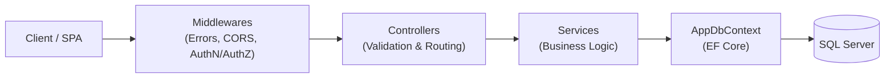
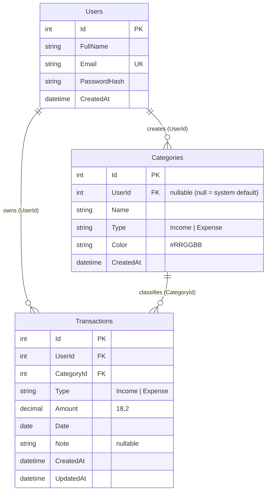

<div align="center">


# Expense Tracker API

**ASP.NET Core Web API on .NET 10 powering a multi-tenant personal finance tracker with SQL Server persistence.**

[](https://dotnet.microsoft.com/) [](https://learn.microsoft.com/aspnet/core) [](https://learn.microsoft.com/ef/core) [](https://www.microsoft.com/sql-server) [-000000?style=flat&logo=jsonwebtokens&logoColor=white)](https://jwt.io) [](https://expensetracker.tryasp.net/health)

[Landing Page](https://expensetracker.tryasp.net/) • [Health Check](https://expensetracker.tryasp.net/health) • [Live App (Vercel)](https://expense-tracker-almaghrabyali.vercel.app) • Demo: `demo@example.com` / `Demo12345`

</div>

The root URL (`/`) serves a landing page, and `/health` returns `{"status":"healthy"}`. Swagger UI is enabled at `/swagger` in Development only and is not exposed in Production.

## Overview & Key Design Decisions

- **Layered Architecture:** Controllers $\to$ Services $\to$ `AppDbContext` (EF Core) $\to$ SQL Server.
- **No Repository Layer:** EF Core's `DbContext` and `DbSet` already implement the Repository and Unit of Work patterns natively; an extra abstraction layer adds unnecessary indirection without value.
- **DTO / Entity Separation:** Entities are never exposed directly to clients; DTOs enforce DataAnnotations validation and prevent over-posting.
- **Global Exception Handling:** Custom `ExceptionHandlingMiddleware` maps domain exceptions (`AppException`) to RFC 7807 `ProblemDetails` (`application/problem+json`). Unhandled errors log server-side and return generic 500 errors.
- **Tenant Isolation:** Every query and mutation is filtered by `UserId` extracted directly from the verified JWT `sub` claim. Cross-tenant lookups return 404 to avoid leaking resource existence.
- **Database-Level Aggregation:** Reports (`/summary`, `/by-category`, `/monthly`) execute EF Core LINQ group-by/sum queries directly inside SQL Server, avoiding loading transaction lists into memory.

## Tech Stack

- **Runtime & Framework:** .NET 10 (C# 14), ASP.NET Core Web API
- **ORM & Database:** Entity Framework Core 10 (Code-First Migrations), Microsoft SQL Server
- **Security & Authentication:** JWT Bearer tokens (HMAC-SHA256 via `Microsoft.AspNetCore.Authentication.JwtBearer`), password hashing via `BCrypt.Net-Next`
- **Documentation:** OpenAPI / Swagger (`Swashbuckle.AspNetCore` & `Microsoft.AspNetCore.OpenApi`)

## Architecture



## Project Structure

```
backend/
├── ExpenseTracker.slnx                    # .NET 10 solution file
├── README.md                              # Backend reference guide
└── src/ExpenseTracker.Api/
    ├── Controllers/                       # Auth, Categories, Reports, Transactions
    ├── Data/                              # AppDbContext & EF Core Migrations
    ├── Dtos/                              # Request / response contracts & validation
    ├── Entities/                          # User, Category, Transaction, TransactionType
    ├── Exceptions/                        # AppException and HTTP error subtypes
    ├── Extensions/                        # ClaimsPrincipalExtensions (safe UserId extraction)
    ├── Middleware/                        # ExceptionHandlingMiddleware (ProblemDetails)
    ├── Properties/                        # launchSettings.json & publish profiles
    ├── Services/                          # IAuthService, ICategoryService, etc.
    ├── Validation/                        # MaxDecimalPlacesAttribute
    ├── appsettings.json                   # Configuration defaults
    └── Program.cs                         # DI configuration, pipeline & endpoints
```

## Database



- **Indexes:** Unique `Users(Email)`, `Categories(UserId)`, `Transactions(CategoryId)`, and composite `Transactions(UserId, Date)`.
- **Cascade Behavior:** `Users` cascades delete to `Categories` and `Transactions`; `Categories` has `Restrict` on `Transactions` (cannot delete category with existing transactions).
- **Default Categories:** 12 immutable system categories (`UserId = null`, seeded): Expense (Food, Transport, Bills, Shopping, Health, Entertainment, Education, Other); Income (Salary, Freelance, Gift, Other).

## Business Rules & Validation Limits

- **User Isolation:** All records are scoped to the authenticated user. Cross-user access returns `404 Not Found`.
- **System Categories:** Shared defaults (`UserId = null`, IDs 1–12) cannot be edited or deleted (`403 Forbidden`).
- **Category Uniqueness & Deletion:** Category names are unique per type across user and default categories (`409 Conflict`). Deleting a category with active transactions returns `409 Conflict`.
- **Category Type Immutability:** Category type cannot be modified via `PUT` to maintain transaction integrity.
- **Type Compatibility:** A transaction's `Type` (`Income` | `Expense`) must match its category's `Type` (`400 Bad Request`).
- **Amounts:** Must be positive ($0.01 \le \text{amount} \le 999,999,999.99$) with at most 2 decimal places (`[MaxDecimalPlaces(2)]`).
- **Dates & Range Limits:** Dates are required (`yyyy-MM-dd`); query filters require `from` $\le$ `to` (`400 Bad Request`); report `year` must be between 2000 and 2100.
- **Inputs:** `FullName` (2–100 chars); `Email` (valid format, max 256 chars, normalized to lowercase); `Password` (8–72 chars due to BCrypt limit); `Category.Name` (1–50 chars); `Color` (regex `^#[0-9A-Fa-f]{6}$`); `Note` (max 250 chars); paging `pageSize` (1–100, default 10).

## API Reference

All API routes are prefixed with `/api` except `/health`.

| Method | Endpoint | Auth | Purpose | Key Query Parameters |
|:---|:---|:---:|:---|:---|
| **POST** | `/api/auth/register` | None | Register a new user | — |
| **POST** | `/api/auth/login` | None | Authenticate and obtain JWT | — |
| **GET** | `/api/auth/me` | Bearer | Get current user profile | — |
| **GET** | `/api/categories` | Bearer | List default & user categories | `type` (`Income` \| `Expense`) |
| **POST** | `/api/categories` | Bearer | Create a custom category | — |
| **PUT** | `/api/categories/{id}` | Bearer | Update category name & color | — |
| **DELETE** | `/api/categories/{id}` | Bearer | Delete category (fails if used) | — |
| **GET** | `/api/transactions` | Bearer | Paged, sorted transaction list | `type`, `categoryId`, `from`, `to`, `search`, `sortBy`, `sortDir`, `page`, `pageSize` |
| **GET** | `/api/transactions/{id}` | Bearer | Get transaction by ID | — |
| **POST** | `/api/transactions` | Bearer | Create transaction | — |
| **PUT** | `/api/transactions/{id}` | Bearer | Full update of transaction | — |
| **DELETE** | `/api/transactions/{id}` | Bearer | Delete transaction | — |
| **GET** | `/api/reports/summary` | Bearer | Income, expense & balance totals | `from`, `to` |
| **GET** | `/api/reports/by-category` | Bearer | Totals and percentages by category | `type` (default `Expense`), `from`, `to` |
| **GET** | `/api/reports/monthly` | Bearer | 12-month income/expense breakdown | `year` (defaults to current year) |
| **GET** | `/health` | None | Service liveness probe | — |

**Example 1: Login Response (`POST /api/auth/login`)**
```json
{
  "token": "eyJhbGciOiJIUzI1NiIsInR5cCI6IkpXVCJ9...",
  "expiresAt": "2026-11-21T14:00:00Z",
  "user": { "id": 1, "fullName": "Demo User", "email": "demo@example.com" }
}
```

**Example 2: Create Transaction Request (`POST /api/transactions`)**
```json
{
  "type": "Expense",
  "categoryId": 1,
  "amount": 42.50,
  "date": "2026-11-21",
  "note": "Groceries"
}
```

## Authentication & Error Shapes

- **JWT Tokens:** HS256 signed tokens containing `sub` (user ID), `email`, and `name`. Tokens expire after 60 minutes with zero clock skew (`ClockSkew = TimeSpan.Zero`). Logout is handled client-side by discarding the token.
- **Security:** Passwords are hashed with salted BCrypt (72-char limit prevents DoS); EF Core queries use parameterized SQL; strict CORS origin checks; user IDs are extracted exclusively from token claims (`User.GetUserId()`), never from request payloads.

The API produces three error response shapes:
1. **Business Error (`application/problem+json`):** `{"status": 409, "title": "Conflict", "detail": "A Expense category named 'Food' already exists."}`
2. **Validation Error (HTTP 400):** `{"type": "...", "title": "Validation failed", "status": 400, "errors": {"Amount": ["Value must have at most 2 decimal places."]}}`
3. **Unauthorized (HTTP 401):** Returns an empty body (`Content-Length: 0`) on missing, invalid, or expired tokens.

## Configuration

Configuration values are defined in `appsettings.json` and overridden in production via environment variables (using double-underscore `__` syntax).

| Key | Environment Variable | Secret? | Purpose |
|:---|:---|:---:|:---|
| `ConnectionStrings:DefaultConnection` | `ConnectionStrings__DefaultConnection` | **Yes** | SQL Server connection string |
| `Jwt:Key` | `Jwt__Key` | **Yes** | HMAC-SHA256 signing key (32+ chars) |
| `Jwt:Issuer` / `Jwt:Audience` | `Jwt__Issuer` / `Jwt__Audience` | No | Token issuer and audience identifiers |
| `Jwt:ExpiryMinutes` | `Jwt__ExpiryMinutes` | No | Token validity duration in minutes (default 60) |
| `Cors:AllowedOrigins` | `Cors__AllowedOrigins__0`, `__1` | No | Whitelisted frontend origins (no trailing slash) |
| `ASPNETCORE_ENVIRONMENT` | `ASPNETCORE_ENVIRONMENT` | No | `Development` or `Production` (disables Swagger) |

## Running Locally (Windows PowerShell)

**Prerequisites:** .NET 10 SDK, SQL Server LocalDB (`sqllocaldb start MSSQLLocalDB`), and `dotnet-ef` global tool.

```powershell
# 1. Trust development certificate
dotnet dev-certs https --trust

# 2. Set local JWT key in user secrets (at least 32 characters)
dotnet user-secrets set "Jwt:Key" "development-secret-key-must-be-at-least-32-chars-long!" --project src/ExpenseTracker.Api

# 3. Apply database migrations & seed default categories
dotnet ef database update --project src/ExpenseTracker.Api

# 4. Run the API (https://localhost:7105, http://localhost:5041)
dotnet run --project src/ExpenseTracker.Api --launch-profile https
```

Swagger UI is accessible at `https://localhost:7105/swagger`.

| Issue | Cause & Resolution |
|:---|:---|
| `Jwt:Key is not configured` | Run `dotnet user-secrets set "Jwt:Key" "<32+ chars>" --project src/ExpenseTracker.Api`. |
| Cannot connect to SQL Server | Start LocalDB with `sqllocaldb start MSSQLLocalDB` and re-run migrations. |
| Port 7105 binding error | Process port collision; free the port or change `launchSettings.json`. |

## Testing

- **Automated Smoke Test:** The live API passed a 14-check automated smoke test suite verifying `/health`, invalid auth rejection (401), user registration, duplicate email handling (409), protected `/me`, default categories seed, transaction creation/rejection, math parity on summary, category percentages, monthly 12-month shape, and deletion.
- **Report Verification:** Summary and category percentage formulas were verified on a fixed 7-transaction dataset.
- **Unit Tests:** Automated unit tests (`backend/tests/`) are not yet implemented in the repository and are scheduled on the roadmap.

## Deployment (MonsterASP.NET)

The API is deployed on MonsterASP.NET running Windows Server/IIS (.NET 10 in-process model) with managed SQL Server:
- **Publish:** Built with `Release` configuration and published directly from Visual Studio via Web Deploy (`.pubxml` is git-ignored).
- **Environment Variables:** Configured in the hosting control panel: `ConnectionStrings__DefaultConnection`, `Jwt__Key`, `Cors__AllowedOrigins__1` (Vercel URL), and `ASPNETCORE_ENVIRONMENT=Production`.
- **SSL & Migrations:** HTTPS is enforced using a free Let's Encrypt certificate. Migrations are executed manually from the developer workstation using `dotnet ef database update --connection "<ProdConnectionString>" --project src/ExpenseTracker.Api` and do not run at application startup.

**Common Pitfalls:**
1. **HTTP 500.30 Startup Failure:** App crashes on boot if `Jwt__Key` is missing from environment variables or is shorter than 32 characters.
2. **CORS Rejection:** `Cors__AllowedOrigins__1` must match the frontend URL exactly with no trailing slash (`/`).
3. **Mixed Content Block:** An HTTPS frontend cannot query an HTTP endpoint; always configure secure HTTPS endpoints.

## Roadmap

- [ ] Automated unit & integration tests using xUnit, Moq, and Testcontainers (SQL Server).
- [ ] Refresh token rotation with sliding expiration stored in `httpOnly` cookies.
- [ ] ASP.NET Core rate limiting middleware on authentication endpoints.
- [ ] Category-based monthly spending budgets and alerts.
- [ ] CSV and PDF export endpoints for financial reports.
