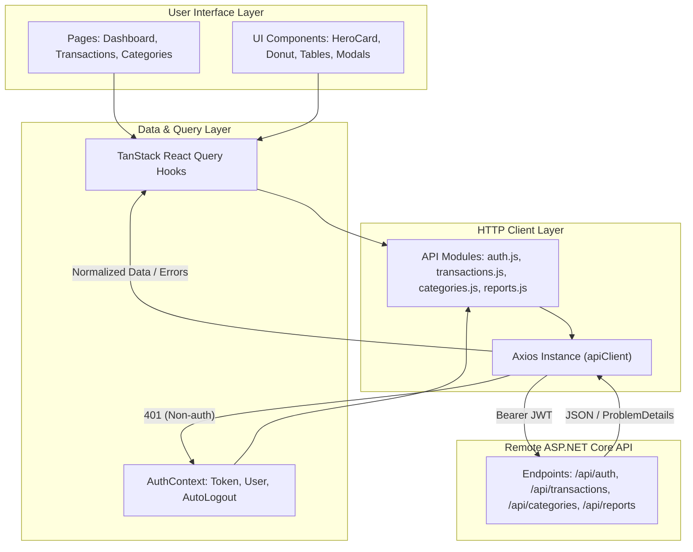

<div align="center">


# Expense Tracker — Frontend

**A modern, accessible, bilingual (English LTR / Arabic RTL) personal finance web application calibrated in Egyptian Pounds (EGP).**

[](https://react.dev/)
[](https://vitejs.dev/)
[](https://tailwindcss.com/)
[](https://tanstack.com/query)
[](https://vitest.dev/)
[](https://eslint.org/)
[](https://vercel.com/)

[Live Application](https://expense-tracker-almaghrabyali.vercel.app) • [Live API](https://expensetracker.tryasp.net) • [API Health Check](https://expensetracker.tryasp.net/health) • [Full Project Documentation](../README.md)

</div>

---

## Overview

The Expense Tracker frontend is a Single Page Application (SPA) built with React 19, Vite 8, and Tailwind CSS v4. It delivers a fast, responsive personal expense management interface backed by an ASP.NET Core Web API with Microsoft SQL Server.

### Live Demo & Public Credentials

- **Live Web App:** [https://expense-tracker-almaghrabyali.vercel.app](https://expense-tracker-almaghrabyali.vercel.app)
- **Production API:** [https://expensetracker.tryasp.net](https://expensetracker.tryasp.net) (Health status: [/health](https://expensetracker.tryasp.net/health))
- **Demo Account Credentials:**
  - **Email:** `demo@example.com`
  - **Password:** `Demo12345`

---

## Table of Contents

- [Features](#features)
- [Screenshots](#screenshots)
- [Tech Stack](#tech-stack)
- [Architecture & Data Flow](#architecture--data-flow)
- [Folder Structure](#folder-structure)
- [Environment Variables](#environment-variables)
- [Getting Started Locally](#getting-started-locally)
- [Testing & Code Quality](#testing--code-quality)
- [Deployment](#deployment)
- [Accessibility & Responsive Design](#accessibility--responsive-design)
- [Roadmap](#roadmap)

---

## Features

### Authentication & Session Lifecycle
- **Sign In & Sign Up:** Single-column glass card layout with ambient CSS/SVG mesh glows and decorative finance elements.
- **Session Restoration:** Automatically verifies active tokens against `GET /api/auth/me` on startup without unnecessary re-verification during locale changes.
- **Auto-Logout:** Client-side timer tracks JWT expiration and signs out gracefully with a translated toast notice.
- **Token Interception:** Axios attaches `Bearer <token>` to all protected calls. Non-auth `401 Unauthorized` responses automatically trigger token purge and session cleanup via custom DOM events (`et:session-expired`).

### Dashboard & Analytics
- **Date Presets:** Quick filtering for *This Month*, *Last 30 Days*, *This Year*, or custom date ranges.
- **Hero Balance Card:** Shows total net balance, income, expense, and percentage delta compared to the previous period of identical length.
- **Metric Cards:** Real-time Total Income, Total Expenses, and Spending/Burn Rate percentage (`Expense / Income * 100`).
- **Category Breakdown:** Interactive SVG donut chart (Recharts) detailing expenditure proportion with color-coded legends.
- **12-Month Cashflow:** Monthly bar chart comparing annual inflow vs. outflow.
- **Recent Transactions:** Quick-access list displaying the 5 most recent transactions with immediate "Add Expense" shortcuts.

### Transactions Management
- **View Options:** Responsive desktop data table and mobile touch cards.
- **Filtering & Search:** Filter by Type (*Income*/*Expense*), Category, Date Range, and 300ms debounced Keyword Search across transaction notes.
- **Sorting & Pagination:** Server-driven sorting by date/amount and paginated navigation.
- **Transaction Modal:** Add and edit modals with atomic form reset, category type filtering, numeric validation, and date pickers.

### Category Management
- **Default Categories:** 12 immutable system categories (Food, Transport, Bills, Shopping, Health, Entertainment, Education, Salary, Freelance, Gift, Other) localized seamlessly in Arabic.
- **Custom Categories:** Create user-defined categories with custom titles and a 10-color hex palette picker.
- **Deletion Protection:** Prevents deleting system categories (403) and surfaces a specialized dialog when attempting to delete categories with existing transactions (409 Conflict).

### Bilingual & RTL Support
- **Full RTL Mirroring:** Complete interface inversion when switching between English (LTR) and Arabic (RTL).
- **Typography:** Uses Inter for English and Cairo for Arabic typography.
- **Number & Currency Formatting:** Strict Egyptian Pound formatting (`EGP 14,519.50` in English, `14,519.50 ج.م` with Western digits in Arabic).
- **Localized Backend Errors:** ProblemDetails RFC 7807 server responses are mapped to localized Arabic and English error strings.

---

## Screenshots

> *Screenshots are stored in `../docs/screenshots/` and documented below:*

| View | Screenshot Reference | Description |
| :--- | :--- | :--- |
| **Login (English)** | `../docs/screenshots/01-login-en.png` | Centered glass card with ambient glows and floating finance shapes |
| **Dashboard (English)** | `../docs/screenshots/02-dashboard-en.png` | LTR layout with Hero balance, stat cards, donut chart, and cashflow bars |
| **Dashboard (Arabic)** | `../docs/screenshots/03-dashboard-ar.png` | RTL layout with Cairo typography, mirrored cards, and localized EGP currency |
| **Transactions List** | `../docs/screenshots/04-transactions-en.png` | Filter bar, sorting, pagination, and action buttons |
| **Transaction Modal** | `../docs/screenshots/05-add-transaction-modal.png` | Add/edit modal with segmented type toggle and category dropdown |
| **Categories Management** | `../docs/screenshots/06-categories-en.png` | Default locked categories and custom color-picked categories |
| **Mobile View** | `../docs/screenshots/07-mobile-dashboard.png` | Compact mobile layout with bottom navigation dock and quick-add button |

---

## Tech Stack

All package versions match `package.json`:

| Layer | Technology | Version | Purpose |
| :--- | :--- | :--- | :--- |
| **Runtime & Core** | React | `^19.0.1` | Modern component architecture |
| **Build Tool** | Vite | `^8.3.0` | Ultra-fast HMR and bundling |
| **Styling** | Tailwind CSS | `^4.3.3` | Utility-first styling with `@tailwindcss/vite` |
| **State Management** | TanStack React Query | `^5.106.1` | Server-state caching and synchronization |
| **HTTP Client** | Axios | `^1.21.0` | REST API communication with interceptors |
| **Forms** | React Hook Form | `^7.91.0` | Lightweight form validation and state |
| **Routing** | React Router | `^7.18.5` | Client-side routing with protected routes |
| **Charts** | Recharts | `^3.10.1` | Donut and bar data visualizations |
| **Internationalization** | i18next / react-i18next | `^26.7.1` / `^17.1.12` | English/Arabic translations and RTL direction |
| **Icons** | Lucide React | `^0.546.0` | Clean, accessible SVG icons |
| **Notifications** | React Hot Toast | `^2.6.1` | Non-blocking toast notifications |
| **Linting** | ESLint | `^9.39.5` | Flat Config code quality enforcement |
| **Testing** | Vitest | `^5.1.0` | Unit and component test runner |

---

## Architecture & Data Flow



### Key Architectural Patterns
1. **Local Date Precision:** All date utilities (`src/utils/dates.js`) compute dates using local year, month, and day parts (`yyyy-MM-dd`) rather than `toISOString()`. This avoids 1-day UTC shifts in Egyptian timezones (UTC+2 / UTC+3).
2. **Selective Query Retries:** React Query's `retry` handler is configured to never retry HTTP `4xx` client errors, while retrying network errors (status 0) and `5xx` server faults.
3. **Clean 401 Interception:** Axios interceptors differentiate between failed login/register attempts (which return user-facing error messages) and expired sessions on protected resources (which dispatch `et:session-expired` and purge auth tokens).
4. **Dynamic Document Direction:** Language changes via `src/i18n/index.js` update both `document.documentElement.setAttribute('dir', 'ltr' | 'rtl')` and `lang="en" | "ar"`, dynamically reloading styles and logical CSS properties.

---

## Folder Structure

Real tree of the `src/` directory:

```
src/
├── main.jsx                       # Application mount and StrictMode wrapper
├── App.jsx                        # QueryClient provider, router, and toaster
├── index.css                      # Tailwind v4 theme, fonts, and custom utilities
├── api/                           # Backend API service modules
│   ├── auth.js                    # login, register, getMe
│   ├── categories.js              # getCategories, create, update, delete
│   ├── client.js                  # Axios client, interceptors, error normalization
│   ├── reports.js                 # getSummary, getByCategory, getMonthly
│   └── transactions.js            # getTransactions, getById, create, update, delete
├── components/                    # Modular UI components
│   ├── categories/                # CategoryRow, CategoryFormModal, CannotDeleteDialog
│   ├── charts/                    # ExpenseDonut, MonthlyBars
│   ├── dashboard/                 # HeroBalanceCard, StatCard, DateRangeSelector, RecentTransactions
│   ├── layout/                    # AppLayout, PublicLayout, Sidebar, TabletRail, MobileDock, MobileTopBar
│   ├── transactions/              # FilterBar, TransactionsTable, TransactionCard, TransactionFormModal
│   └── ui/                        # Button, Input, Select, Modal, ConfirmDialog, Badge, ErrorState, Logo, etc.
├── context/
│   └── AuthContext.jsx            # Authentication state, auto-logout timer, session recovery
├── hooks/                         # Query & utility hooks
│   ├── useCategories.js           # useCategories, mutations with toast integration
│   ├── useDebounce.js             # 300ms debounce hook for keyword search
│   ├── useReports.js              # useSummary, useByCategory, useMonthly
│   └── useTransactions.js         # useTransactions, mutations with query invalidation
├── i18n/
│   ├── index.js                   # i18next configuration, RTL document listener
│   └── locales/
│       ├── ar.json                # Arabic translations
│       └── en.json                # English translations
├── pages/                         # Route destination views
│   ├── Categories.jsx             # Category management page
│   ├── Dashboard.jsx              # Main analytics and balance dashboard
│   ├── Login.jsx                  # Sign in page
│   ├── NotFound.jsx               # 404 fallback page
│   ├── Register.jsx               # Registration page
│   └── Transactions.jsx           # Transactions table and card page
├── routes/
│   ├── ProtectedRoute.jsx         # Auth guard redirecting to /login
│   ├── PublicRoute.jsx            # Guest guard redirecting to /
│   └── index.jsx                  # React Router configuration
├── test/                          # Unit and integration test suite
│   ├── apiClient.test.js          # Interceptor and token header tests
│   ├── categoryName.test.js       # Category translation and custom preservation tests
│   ├── components.test.jsx        # Dialog, modal, and route guard tests
│   ├── dates.test.js              # Local date calculation and preset tests
│   ├── datesSingleDay.test.js     # Single day custom range tests
│   ├── errors.test.js             # RFC 7807 error parsing and localization tests
│   ├── format.test.js             # Money and date formatting tests
│   ├── i18n.test.js               # Key parity and locale coverage tests
│   ├── reports.test.js            # Reports query argument verification
│   ├── setup.js                   # Vitest matchers setup
│   └── uiImprovements.test.jsx    # Logo, layout, and button wrapping tests
└── utils/                         # Pure utility functions
    ├── categoryName.js            # getCategoryDisplayName, getCategoryInitial
    ├── constants.js               # STORAGE_KEYS, DEFAULT_CATEGORIES, PRESET_COLORS, DATE_PRESETS
    ├── dates.js                   # formatLocalDate, parseLocalDate, getPresetDates, getPreviousPeriodDates
    ├── errors.js                  # normalizeApiError, getLocalizedErrorMessage
    └── format.js                  # formatMoney, formatDate, calculatePeriodChange
```

---

## Environment Variables

The application relies on a single environment variable:

| Variable | Description | Local Development | Production (Vercel) |
| :--- | :--- | :--- | :--- |
| `VITE_API_URL` | Base URL of the ASP.NET Core backend | `https://localhost:7105` | `https://expensetracker.tryasp.net` |

Create a `.env` file in the `frontend/` directory (copied from `.env.example`):

```bash
# Windows PowerShell
Copy-Item .env.example .env

# Bash / macOS / Linux
cp .env.example .env
```

---

## Getting Started Locally

### Prerequisites
- Node.js 20+ installed
- ASP.NET Core backend running locally at `https://localhost:7105` (or use the live API URL `https://expensetracker.tryasp.net`)

### 1. Installation
Install project dependencies:

```bash
npm install
```

### 2. Run Local Development Server
Start Vite on port 5173:

```bash
npm run dev
```

The application will be available at [http://localhost:5173](http://localhost:5173). Note that `strictPort: true` is configured in `vite.config.js` because the backend API's CORS configuration specifically whitelists `http://localhost:5173`.

---

## Testing & Code Quality

### Running Unit & Component Tests
The project features **64 Vitest tests** covering utilities, state transitions, date operations, localized errors, and UI components:

```bash
npm test
```

### Linting with ESLint 9
ESLint is configured using the modern Flat Config (`eslint.config.js`) supporting React 19, Hooks, and Vitest globals:

```bash
npm run lint
```

### Production Build Verification
Test the production bundle locally:

```bash
npm run build
npm run preview
```

---

## Deployment

The application is deployed on **Vercel** with automatic continuous deployment on pushes to `main`.

### Vercel Configuration Settings
- **Root Directory:** `frontend`
- **Framework Preset:** `Vite`
- **Build Command:** `npm run build`
- **Output Directory:** `dist`
- **Environment Variables:**
  - `VITE_API_URL=https://expensetracker.tryasp.net`

### Client-Side Route Handling
Single-page navigation is preserved on page refresh through [`vercel.json`](vercel.json):

```json
{
  "rewrites": [
    { "source": "/(.*)", "destination": "/index.html" }
  ]
}
```

---

## Accessibility & Responsive Design

- **Viewport Adaptability:** Tested across 360px (mobile), 768px (tablet), 1024px (laptop), and 1440px (desktop).
  - `>=1280px`: Full persistent desktop sidebar with navigation labels.
  - `768px - 1279px`: Compact icon rail maximizing analytical screen space.
  - `<768px`: Clean top header bar and a fixed bottom dock with an elevated quick-add button.
- **Button Wrap Protection:** All action buttons utilize `whitespace-nowrap` and minimum target heights (44px on mobile) to prevent labels from breaking across lines in Arabic and English.
- **Screen Reader Support:** Interactive icons include descriptive `aria-label` tags, preset selectors feature `aria-pressed`, and decorative background items are flagged with `aria-hidden="true"`.
- **Keyboard Navigation:** Forms support full tab traversal, visible emerald focus rings, and Esc dismissal on modal dialogs.

---

## Roadmap

- [x] Initial React 19 + Vite 8 SPA setup with Tailwind CSS v4
- [x] ASP.NET Core JWT integration with auto-refresh and session recovery
- [x] Bilingual English / Arabic with complete RTL layout mirror
- [x] Analytics dashboard with Recharts donut and cashflow bars
- [x] Category management with locked defaults and 409 conflict detection
- [x] Production deployment on Vercel with automated CI/CD
- [ ] Export transactions to CSV and formatted PDF reports
- [ ] Category-based monthly budget limits with threshold alert banners
- [ ] Recurring transactions scheduling
- [ ] User profile customization and avatar upload
